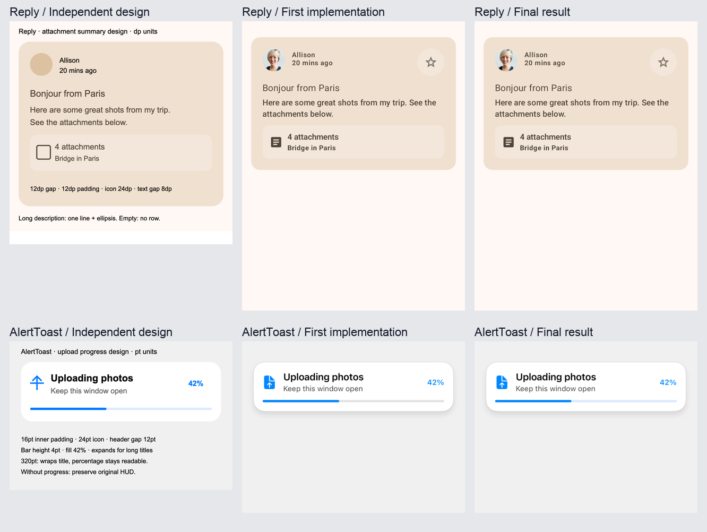

# Native UI Agent

让 coding agent 在已有 iOS / Android 工程中实现 UI，通过真实原生渲染、看图、可测量断言和源码修正交付结果。

这个仓库包含可加载的 **Skill**、确定性的 **证据 runner**，以及两个真实开源工程的接入代码和实跑记录。模型由宿主 coding agent 提供；runner 不内置 LLM，也不假装提供通用完整的原生样式树。

## 本轮 v5：覆盖改善，采集成本增加，质量优势未证实

冻结可执行的多目标观测和逐状态断言编译后，独立设计全新 Print Batch Approval，比较冻结 Skill v4 / v5。两组都用 Skill；88 次计划原生采集、1891 个快照记录及 3 次失败尝试全部保留。四阶段双组评分先封存，再揭盲。

**同源码配对：**运行时未评估 **54.39% → 40.85%**，新增 **2424** 行证据（1470 原生类、954 视觉），没有丢失或已裁定冲突；命令资源时间 **365.634 → 734.914 秒，+101.00%**。这些是同源码工具证据，不能替代代码质量结论。

| 不同实现的开发结果 | Skill v4 | Skill v5 |
| --- | ---: | ---: |
| 成功刺激业务漏检 | N/A：无自然 F | N/A：无自然 F |
| 首版运行时合并漏检† | 0/23 | 53/122，43.44% |
| 首次主张条件误报占比 FP/(TP+FP) | 137/(46+137)，74.86% | 114/(46+114)，71.25% |
| 未裁定 / 未映射主张 | 376 | 415 |
| 首版 F→最终 P / F / U† | 0 / 0 / 23 | 53 / 46 / 23 |
| 最终运行时未评估 | 5878/14324，41.04% | 5880/14324，41.05% |
| 实现开始→自身最终语料封存，含等待 | 34:50.7 | 35:35.2 |

†原子失败行不是独立 bug。新版漏了46条字体规则：代码和自测把同一设计预期写错，逐状态矩阵无法自动纠正。两组各23个原始 AX 尺寸 F 修复后变为48±2pt，仍为 U，不算通过。新版最终仍有74条字体 F。误报条件比例之外，未知主张两端范围分别24.51%–91.77% / 19.83%–92.00%；不能宣称误报已显著下降，缺完整 TN 分母时经典 FPR 不可得。

[完整报告](validation/state-forward/RESULTS.md)、[全部表格与成本](validation/state-forward/TABLES.md)、[原因分析](validation/state-forward/ANALYSIS.md)、[通用实现](validation/state-forward/ENGINEERING.md)、[共同修正](validation/state-forward/INFRASTRUCTURE.md)、[失败记录](validation/state-forward/FAILURES.md)、[原图](validation/state-forward/GALLERY.md)、[复现](validation/state-forward/REPRODUCE.md)。iOS 数值样式和物理点击区域缺口继续记 U；CI 验证证据完整性，不表示组件验收全部通过。

## 上一轮 v4：采集显著变快，未证实覆盖和漏检改善

先修复回调断言的成功原生派发前置条件，再冻结通用优化；独立设计全新 WaterRound 放水审批组件，在 AlertToast / Reply 生产模块中盲测。两组均用 Skill，对比共同修复后的 v3 与 v4；全部独立评分、自查匹配和同源码配对封存后才揭盲。

| 双端指标 | common-v3＋共同修复 | candidate-v4 |
| --- | ---: | ---: |
| 成功请求刺激后的业务漏检 | N/A：没有自然 F | 6/8，75.0% |
| 可裁定映射发现误报占比 FP/(TP+FP) | 0/5 | 0/8 |
| 首版运行时 F→最终 P† | 12/12 | 20/22 |
| 最终运行时未评估 | 1625/3470，46.8% | 1545/3470，44.5% |
| 实现开始→自身最终语料封存，含等待 | 90:14.6 | 52:26.0 |

†冻结 F 行包含重复症状和数值边界，不能当作独立 bug 数。新版八个业务 F 来自一个装饰勾号并入 AX 名称的问题，自查只明确报告两个状态；一次共因修复使八项通过，但不倒填六项检出信用。两组最终 Android 各两行 `47.99994 dp < 48 dp` 的严格阈值 F 保留，不解读为有意义的尺寸缺陷。未映射旧/新 7/2 条发现及旧组一条不确定发现另列，0 个确认误报不代表其余发现都正确。

**同源码配对更能说明工具收益：**iOS 命令耗时降低 89.3%–89.4%，Android 降低 47.3%–57.1%；合计 53:34.6→6:26.7。运行时新增 2 项证据、失去 3 项，净 −1，无判定冲突。因此没有证实覆盖提升。两份不同实现的最终 U 比例差不能归因为工具。回调门控、宿主、输入翻译和评估格式修正是共同基础设施。

完成 68 次计划采集，保留 1474 个快照记录、额外失败尝试和编译日志。禁用/未派发后的空回调仍为未评估；字号、内部 padding、物理 hit 等能力缺口也继续保留。不能声称整屏或业务全部通过。

[完整新报告](validation/dispatch-forward/RESULTS.md)、[完整表格与成本](validation/dispatch-forward/TABLES.md)、[通用实现](validation/dispatch-forward/ENGINEERING.md)、[失败记录](validation/dispatch-forward/FAILURES.md)、[原图与修正](validation/dispatch-forward/GALLERY.md)、[复现说明](validation/dispatch-forward/REPRODUCE.md)。旧轮次原始得分与负面结论保持不变。

## 上一轮 v2 / v3：观测覆盖改善，采集成本上升

完成全新退款/换货组件的两组盲测、同源码采集器配对与 68 次计划原生采集，保留 3,212 张快照。全部主评分、发现匹配、配对评分封存后才揭盲；两组均使用 Skill。

| 指标，双端合计 | 旧 v2 | 新 v3 |
| --- | ---: | ---: |
| 确认误报发现占比 FP/(TP+FP) | 0/21，0% | 0/10，0% |
| 漏检，冻结原子口径† | 34/55，61.8% | 0/10，0% |
| 最终运行时未评估 | 208/2518，8.3% | 198/2518，7.9% |
| 首版评分失败转为通过† | 55/55，100% | 10/10，100% |
| 自查 / 修复秒数 | 547.296 / 774.762 | 600.000 / 746.000 |

†旧组 28 个首版失败、2 个最终失败是未成功派发动作后的回调区间事实，不能证明业务 handler 错误；不能把这些分数当作独立业务 bug 数。业务漏检优势也受此评分前提限制。未裁定和缺证据项继续保留，经典误报率因无完整 TN 分母不可得。

更能隔离工具能力的同源码配对：运行时未评估 **26.0% → 10.1%**，新获得 296 项证据、失去 5 项，净改善 291 项；采集命令 **56:48 → 96:27**，增加约 69.8%。公共 JSON、宿主与排程修复均不算新版独有收益。两组确认误报占比和首版失败转通过率相同，不能声称这两项提升。

两组实际自查语料采集耗时为 56:48 / 2:49:07，不能只报自查分钟数。旧组首版跨服务中断，精确活跃耗时不可得；一个任务、相关平台、没有人类金标准，结果只支持描述性比较。

[完整报告与归因限制](validation/tool-forward/RESULTS.md)、[完整指标与耗时](validation/tool-forward/TABLES.md)、[失败记录](validation/tool-forward/FAILURES.md)、[原始图片](validation/tool-forward/GALLERY.md)。本轮原始得分与未成功尝试全部保留，未针对结果修改业务代码或工具后重算。

## 前一轮三臂盲测：未证实新版额外收益

先冻结通用改进，再由独立上下文设计全新的服务预约改期组件；比较无 Skill、冻结 v1、改进 v2。完成84组原生采集、1,086张快照及双端各1次干净检出复跑，先封存评分和自查匹配再揭盲。

| 指标，双端合计 | 无 Skill | v1 | v2 |
| --- | ---: | ---: | ---: |
| 首版确认缺陷簇 | 3 | 2 | 2 |
| 精确规则检出 TP / FN | 13 / 0 | 7 / 0 | 7 / 0 |
| 首版确认失败修复 | 13/13 | 7/7 | 7/7 |
| 确认误报规则项 | 0* | 3 | 4 |
| 最终 iOS 原始评分：通过/失败/未评估 | 82/0/2 | 76/0/8 | 76/0/8 |
| 实现＋自查＋修复 | 24:09.5 | 21:58.1 | 20:50.0 |

*无 Skill 另有2项未裁定发现，含类似AX包装节点质疑；0项确认误报不代表没有可疑误判。原始评分里的部分通过还带有未测子方面，例如R13的物理触摸区域，**不能解释为整条要求完整通过**。独立覆盖附录进一步列明范围：完整要求通过率无法得出；排除已知触摸区域缺证据后，最终iOS可能完整支持的项数至多为75/69/69，这些仍不是已验证通过数。

三组都找全并修复了各自已确认的缺陷；两组 Skill 的极端长内容目标搜索留下额外6项未评估。新观测器是三组共享能力，不能把其收益算作 v2 独享收益。一个任务、每组一次运行、共享硬件和缓存，也不足以证明质量或速度的因果提升。

[完整新报告、图片与覆盖附录](validation/fresh-blind/README.md)、[可复算统计](validation/fresh-blind/result-summary.json)、[首轮原因分析](validation/improvement-analysis.md)。本轮保留了负面结果，没有针对新隐藏用例继续调优后重算。

## 首轮盲测：未观察到额外收益

2026-10-18，独立固定附件传输队列的设计与验收，以相同模型设置、宿主和工具，对比有/无 Skill。首版自查封存后才执行隐藏场景，匿名评分封存后才揭盲；完成 56 次有效原生采集和 4 次干净检出复跑。

| 指标 | 无 Skill | 有 Skill |
| --- | ---: | ---: |
| iOS 首版失败规则项 | 3 | 3 |
| 自查漏检 | 1/3，33.3% | 1/3，33.3% |
| 一轮修复 | 3/3 | 3/3 |
| 保留场景确认新失败 | 0 | 0 |
| 实现＋自查＋修复耗时 | 14:05.7 | 13:37.7 |

三个失败项来自一个窄屏重排缺陷簇。Android 未确认首版缺陷，漏检/修复率分母为零，记 N/A。每组最终 368 个规则项中 223 通过、145 未完整评估，不能称为全部通过。**本轮没有观察到 Skill 的额外检出或修复优势**；单次小样本与共享缓存也不支持提速结论。

完整[盲测报告与前后图片](validation/blind-comparison/README.md)、[可复算统计](validation/blind-comparison/result-summary.json)、[冻结源码](validation/blind-comparison/implementations/)和[独立设计/验收](validation/blind-comparison/design-team/public/brief.md)已归档。报告保留程序性盲法、基础设施修正、iOS 交互和屏幕外视觉的证据限制。Skill 在实验中保持原样。

## 之前的新增功能验证

2026-10-18 在固定上游提交上开发两个新增功能，独立设计与验收标准先于实现提交到 Git，未向生产代码注入已知错误：

| 项目 | 新增 UI | 最终结果 | 源码修正 |
| --- | --- | --- | --- |
| [Android Reply](https://github.com/android/compose-samples) | 邮件卡片附件摘要：数量、首个描述、长文省略、空态隐藏 | **5/5** 场景通过；真实 Activity 点击复验通过 | 首版达标，0 轮；未人为制造错误 |
| [iOS AlertToast](https://github.com/elai950/AlertToast) | 可选上传进度 HUD：百分比、进度条、长标题、旧调用兼容 | **6/6** 场景通过；旧调用像素不变 | 看图发现系统灰轨道偏离浅蓝参考，1 轮样式修正 |

干净检出固定上游提交、应用功能补丁和安装宿主后，两端又各实际渲染 1 次；结果与最终同状态图片一致。



完整的[新增功能开发报告](validation/feature-development/README.md)、[设计冻结清单](validation/feature-development/design/freeze.json)、[机器可读结果](validation/feature-development/result-summary.json)。之前的[受控回归试验](validation/native-ui-pilot/README.md)单独保留，不能与新增开发试验混为一谈。

这一轮新增功能试验本身没有无 Skill 对照组，不能单独据此声称提升了某个百分比的 PR 质量。首次快速视觉检查曾漏过轨道色，详细设计核对才发现；原始通过、后续失败及修正记录均保留。字号、颜色、间距能否精确观测取决于平台和采样对象。

## 通用观测工具 v3 / v4 / v5

新版把 AX 容器与实际控件叶节点判定、长内容反馈定位、输入与回调绑定、逐状态滚动覆盖，以及类型化断言做成可执行工具。歧义、覆盖缺口、无运行时依据的属性保留为未评估；源码声明不能替代实际生效的样式。实测通用控件包括 Button 和 Switch，Android 语义点击不等于操作系统物理触摸。

v4 增加单次公开 iOS AX 快照遍历、经来源与产物校验的编译缓存、动作即时收据后有界重新定位，以及减少冗余采图的通用执行能力。输入、进程、动作、完整滚动证据均重新生成；不复用旧截图。回调的成功派发门控也应用于共同基线。[本轮实现和通用探针](validation/dispatch-forward/ENGINEERING.md)与盲测结果分别公开。

v5 增加有界的动作后多目标观测、严格绑定输入/进程/事件的原始帧合并，以及状态×检查方面的断言编译。目标覆盖不等于完整内容或不存在证明；回调即时区间保持不变。编译器保证声明矩阵的完整性，不能保证预期值正确。[状态证据协议](native-ui-agent/references/state-evidence.md)和[本轮工程与边界](validation/state-forward/ENGINEERING.md)给出可执行接口。

接入与边界见[原生工具协议](native-ui-agent/references/native-tools.md)、[独立通用能力验证](validation/tool-capabilities/REPORT.md)与[新版两组试验](validation/tool-forward/README.md)。业务试验调用真实生产模块中的新增组件，但不覆盖原应用完整页面、导航或后端。

## 前一轮覆盖能力改进

[首轮分析](validation/improvement-analysis.md)把“一个缺陷簇的规则归因遗漏”与“缺少原生运行时证据”分开。新版增加需求×场景×检查方面的证据账本、完整滚动采样要求，以及可接入真实生产 View 的独立 iOS App + XCUITest 观测器。旧版材料和原始得分继续保留，未用旧失败条件定义新版成功。

`coverage.py`检查计划缺项、证据指纹和方法约束；运行时动作不能由源码或视觉判断代替。它不会判断证据的语义真实性。iOS观测器记录实际 AX、屏幕点坐标、截图映射、真实点击和回调，以及同进程调用方更新；它不提供通用 SwiftUI 字号、padding、颜色树。缺失属性继续保留为未评估。

接入方式见[覆盖协议](native-ui-agent/references/coverage.md)、[iOS观测器契约](native-ui-agent/assets/ios-observer/CONTRACT.md)。[独立能力探针](validation/observer-probes/README.md)保留成功与失败记录；生产接入还需让桥接真正导入并调用目标模块，不能只验证一份未使用生产包的简单 View。

## 工作方式

1. 按当前需求、代码改动、调用位置和业务文字定位真实组件，不要求全项目登记业务 ID。
2. 实现前固定独立设计、规则来源及相关状态。新设计线框与原生截图不是同一种像素基准。
3. 生成薄测试宿主，调用生产 UI，控制数据、主题、时间与动画。
4. `capture` 执行真实原生命令，保存本轮图片、原生报告、源码/参考指纹和命令日志。
5. Agent 阅读实际图；`review` 汇总绑定本轮证据的视觉结论与数值/像素断言。
6. 有问题时修改生产源码，重新构建和渲染；组件通过后另做实际页面复验。

`captured` 只表示证据采集成功。缺测试、缺图、缺参考、无测量或未审图都不等于样式通过。不会自动覆盖正式 golden，也不能用旧截图声明新代码通过。

## 使用 Skill

将 [`native-ui-agent/`](native-ui-agent/SKILL.md) 作为宿主 coding agent 可加载的 Skill 目录，或让 agent 直接读取其 `SKILL.md`。该目录可独立复制；`validation/` 是工程接入及验证材料。

只使用 Skill 源码时，可以稀疏拉取这个目录；完整验证档案包含大量原始截图和日志：

```sh
git clone --filter=blob:none --sparse https://github.com/KamisamaJin/native-ui-agent.git native-ui-agent-repo
git -C native-ui-agent-repo sparse-checkout set native-ui-agent
```

示例需求：

> 使用 native-ui-agent，在现有邮件卡片中增加附件摘要。先固定设计参考和验收，再复用工程主题、数据和组件生成测试宿主，渲染普通、长描述、深色和窄屏状态；按图与原生测量修正，提供页面复验及证据。

Skill 目前给出 SwiftUI/UIKit、Compose/Views 的接入指导；仓库实跑覆盖的是 **SwiftUI 和 Compose**。它不自动适配任意旧项目，也不替代业务数据、导航和后端契约测试。

## Runner

Python 3.9+，依赖见 [requirements.txt](native-ui-agent/scripts/requirements.txt)：

```sh
python3 -m pip install -r native-ui-agent/scripts/requirements.txt
python3 native-ui-agent/scripts/ui_loop.py capture \
  --project /path/to/native-project --profile /path/to/case.json \
  --output /path/to/new-evidence-directory
```

Agent 看图后按[协议](native-ui-agent/references/protocol.md)写 `visual-findings.json`：

```sh
python3 native-ui-agent/scripts/ui_loop.py review \
  --capture /path/to/new-evidence-directory/capture.json \
  --findings /path/to/visual-findings.json --output /path/to/new-review-directory
```

每个 profile 对应一个组件状态、一张 actual 图；项目命令使用 argv 数组执行。三类检查分别保留方法和边界：

| 检查 | 能证明什么 |
| --- | --- |
| visual | Agent/人工对实际图与独立参考的判断；可能漏检 |
| numeric | 宿主实际提供的特定测量与期望比较；缺数据为 needs_review |
| pixel | 同尺寸原生图的区域/整图 RGBA 差异；不证明业务或样式属性语义 |

平台接入看[平台适配](native-ui-agent/references/platforms.md)，配置结构看 [Android 示例](native-ui-agent/assets/profile.example.json)、[iOS 示例](native-ui-agent/assets/profile.ios.example.json)。

## 复跑双端新增功能

需要 macOS、已完成首次设置的 Xcode、已安装 iOS 模拟器、Android SDK 36 和 JDK 21；实跑版本与命令详见[报告](validation/feature-development/README.md#复跑)。

```sh
python3 validation/feature-development/prepare.py \
  --workspace /absolute/path/to/new-workspace \
  --android-sdk /absolute/path/to/Android/sdk \
  --java-home /absolute/path/to/jdk-21/Contents/Home \
  --ios-device YOUR_INSTALLED_SIMULATOR_UUID
```

此入口只接受新目录，检出固定提交、应用 host/生产功能补丁、复制测试宿主并生成本机 profiles。不会覆盖已有应用工作目录。功能交付为完整补丁和新文件，不把整个上游仓库及 SDK 上传到这里。

归档 capture 保留当时绝对路径和环境供追溯；迁移机器时使用 `prepare.py` 生成本机配置。不同系统/渲染器可能改变像素，不能直接更新基准消除差异。

## 验证

```sh
python3 -B -m unittest discover -s native-ui-agent/tests -v
python3 validation/feature-development/verify_evidence.py
python3 validation/blind-comparison/verify_evidence.py
python3 validation/observer-probes/verify_preflight.py
python3 validation/fresh-blind/verify_evidence.py
python3 validation/tool-forward/verify_capabilities.py
python3 validation/tool-forward/verify_engineering.py
python3 validation/tool-forward/verify_frozen.py --include-private
python3 validation/tool-forward/metrics.py --self-test
python3 validation/tool-forward/verify_evidence.py
python3 validation/tool-forward/verify_protocol.py
python3 validation/tool-forward/build_summary.py --check
python3 validation/tool-forward/build_tables.py --check
python3 validation/tool-forward/build_failure_index.py
python3 validation/tool-forward/verify_artifacts.py
```

前一轮不含本机缓存的异地 Git 归档核验见[历史核验记录](validation/fresh-blind/verification.json)。当前 55 项单元测试与全部 15 项验证命令已在不含 Git 元数据及本机缓存的异地归档中通过，见[本轮核验记录](validation/tool-forward-verification.json)。

第一条验证 runner、覆盖账本和观测器的协议与失效行为；后续命令跨机器审计归档图片、报告、原生测试数、冻结哈希、盲测封存与统计运算，不运行原生 SDK 或模型。GitHub CI 执行这些检查，不声称重新运行双端模拟器。

## 目录

```text
native-ui-agent/                  可复制的 Skill、runner、协议与测试
validation/feature-development/  新增 UI：冻结设计、功能补丁、宿主、复跑入口与证据
validation/blind-comparison/     首轮有/无 Skill 盲测及冻结v1
validation/fresh-blind/          全新预约UI：无Skill/v1/v2、预注册与原生证据
validation/tool-forward/         全新退款UI：旧v2/新v3、配对采集与完整评分
validation/tool-capabilities/    通用叶节点、长内容与逐状态覆盖原生验证
validation/observer-probes/      独立通用观测能力探针及原始失败
validation/native-ui-pilot/       历史受控回归试验、宿主接入记录及上游许可
```

## License

原创 Skill、runner、文档和宿主代码使用 [MIT](LICENSE)。上游派生组件补丁、截图与生成报告保留各自许可，见 [THIRD_PARTY_NOTICES.md](THIRD_PARTY_NOTICES.md)。克隆工程、构建缓存、SDK、签名文件和本地环境配置由 `.gitignore` 排除。本项目独立于 Android、Apple、Point-Free 及上述开源维护者。
