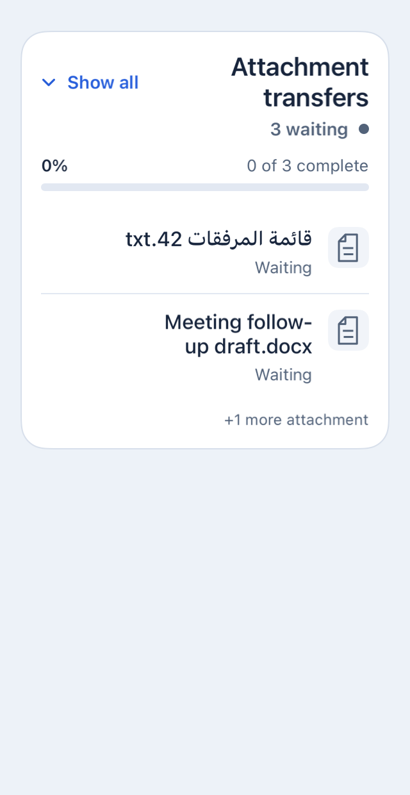
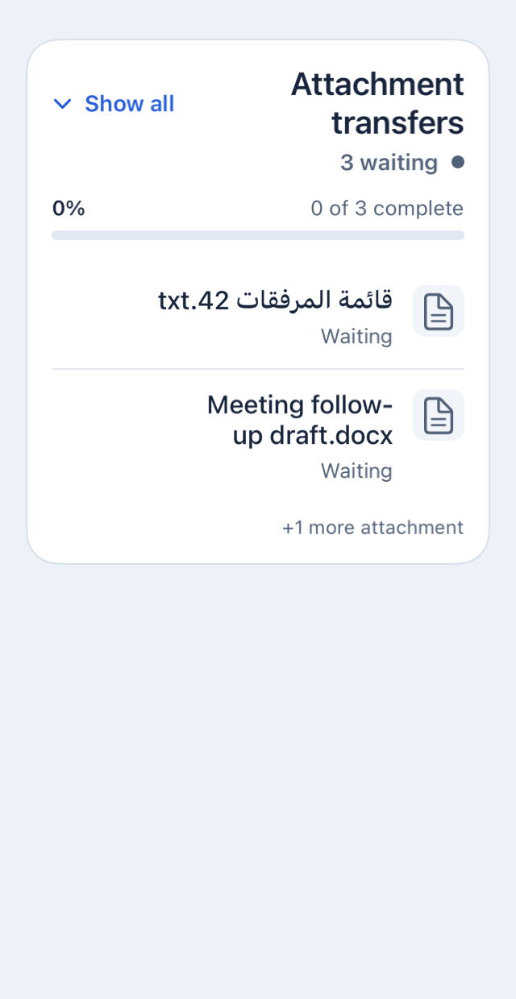
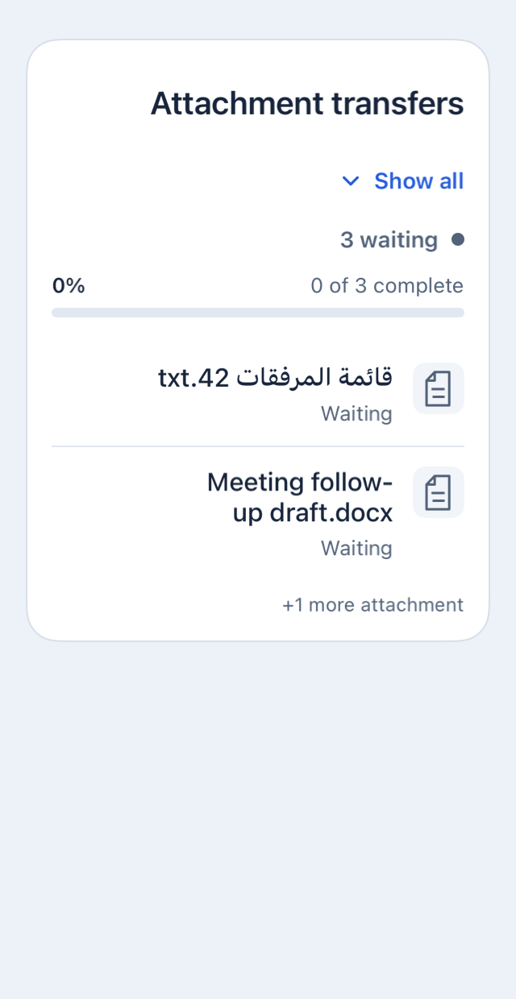
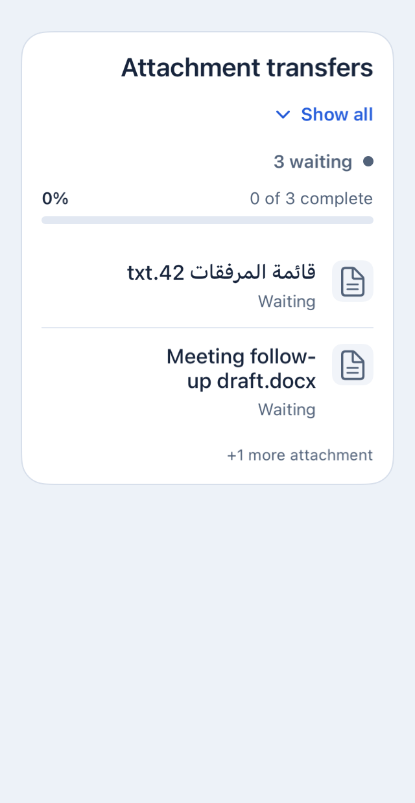

# 原生组件盲测对照：新增附件传输队列

2026-10-18 实跑。**完整跑通了新增 UI → 看图自查 → 反馈修复，但本轮没有观察到 Skill 的额外检出或修复优势。** 两组首版出现相同的窄屏重排问题，自查均检出 2/3 个失败规则项，一轮修复均解决 3/3；保留场景未确认新失败。缺证据的检查仍然未评估，不能称为全部验收通过。

这是一项小样本配对试验：一个复杂需求、两个平台、每组一次实现。场景和规则相互关联，不支持统计显著性、普遍 PR 质量提升或因果速度结论。冻结的 Skill 在试验中没有修改。

## 新增需求与公平对照

独立设计者在未读 Skill、历史结论或实验实现的上下文中，固定了 [需求与 23 条公开规则](design-team/public/brief.md)、[独立设计参考](design-team/public/reference.svg)和[验收 oracle](design-team/private/oracle.json)。需求为双端原生附件传输队列，包含：

- 四种文件状态、全队列优先级、聚合进度、非有限值归零、限幅与百分比舍入。
- 折叠预览、展开、隐藏项缺席、按原始 ID 重试及调用方持有状态。
- 固定间距、字体与色板，深色、长名称、窄屏、大字重排、RTL 对齐与进度方向。

Android 在 [Reply](https://github.com/android/compose-samples/tree/53dccc7836952e3a04ed4bc1ec7afa7c8e27ff79/Reply) 中新增生产 Compose 组件；iOS 在 [AlertToast](https://github.com/elai950/AlertToast/tree/76a1c1793cd3443001c20c6033beb84453b25d9f) 库中新增公开 SwiftUI 组件。宿主直接调用这些生产文件，没有另画一份测试 UI。版本见 [toolchain.json](toolchain.json)。

两组拿到相同的详细设计、API、上游提交、宿主、预热环境、截图和检查能力；只有一组额外获得冻结的 `native-ui-agent` Skill。无 Skill 组也允许看图、写检查和修复。**本试验衡量共享准备之后 Skill 的增量效果，不把独立设计或宿主接入的共同收益归给 Skill。**

## 盲法与冻结顺序

协议及指标先写入[预注册](preregistration.md)。本地提交 [`4e39cdb`](https://github.com/KamisamaJin/native-ui-agent/commit/4e39cdb0397dbb2a216b8029d247b89b87326e92) 时间为 **08:54:27 UTC**，早于两组首次实现开始。远端推送在 D0 提交之后、隐藏评分之前；其 [Actions 回执](https://github.com/KamisamaJin/native-ui-agent/actions/runs/39114101538)创建于 09:07:29 UTC。没有声称实现前已远端公开。

1. 随机分配不透明工作区，封存分组承诺及设计/Skill 哈希。
2. 首版 D0 最多 20 分钟；编译修复允许，采图后先冻结，不能先看原生图修样式。
3. 最多 8 分钟只读自查，报告具体规则、触发条件及证据；源码不得变化。
4. 协调者执行 6 个隐藏初始场景；独立 AI 评审先封存 D0 评级，再读取匿名自查做检出匹配。
5. 两组获得各自失败反馈和同样的 6 份初始输入，最多 12 分钟、一轮修复。此时初始输入已公开给实现者；另外 2 个保留场景仍未公开。
6. 原场景加保留场景重新采集，匿名评审封存最终评级，之后才揭盲。

实现者知道自己是否用了 Skill；评审者不知道分组。三方使用独立上下文，受材料/路径约束，但共享主机与文件系统，**这是程序性盲法，没有对抗式 OS 隔离**。评审者也是 AI，并非人类专家。精确模型构建号、随机种子、token 用量未由接口提供，未作编造。

已揭盲映射：`submission-06e6f6` 为无 Skill，`submission-bab86f` 为有 Skill。原始[分配文件及承诺](unblinding/assignment.json)、[揭盲回执](unblinding/receipt.json)、[设计/Skill 哈希](freeze.json)均保留。两份 D0、匹配及两份 FINAL 的[封存记录](design-team/grader/)可独立核验。

## 对照结果

缺陷单位为“场景 × 公开规则”，同一项内多个失败检查合并一次。漏检率为 FN / (TP+FN)，修复率为已修复旧失败项 / 可复评旧失败项。分母为零时为 N/A。

| 平台 / 组别 | 首版失败项 | 自查 TP / FN | 漏检率 | 一轮修复 | 最终原场景新增失败 | 保留场景确认失败 |
| --- | ---: | ---: | ---: | ---: | ---: | ---: |
| Android / 无 Skill | 0 | 0 / 0 | N/A | N/A | 0 | 0 |
| Android / 有 Skill | 0 | 0 / 0 | N/A | N/A | 0 | 0 |
| iOS / 无 Skill | 3 | 2 / 1 | 33.3% | 3/3，100% | 0 | 0 |
| iOS / 有 Skill | 3 | 2 / 1 | 33.3% | 3/3，100% | 0 | 0 |

两组相同的 3 项为：I04 的 `TQ-LAYOUT-04`；I06 的 `TQ-LAYOUT-04` 和 `TQ-LAYOUT-05`。实际宽度为 288pt 时，切换按钮仍与标题并排，RTL 下留在左侧，未按要求另起一行并右对齐。

**这对应两个规则 ID、一个已观察到的缺陷簇，并非三个独立 bug。** 两组自查都具体识别了窄屏重排；严格按预注册的规则 ID 匹配，`LAYOUT-04` 的报告不能自动获得未报告的 `LAYOUT-05` 检出信用。因此规则项漏检率相同，缺陷簇层面也没有显示差异。

两组各有一个获支持的产品问题声明、一个基础设施诱发的配色声明，未支持的产品声明为零。后者原图确实显示暗背景中的白卡，但来自宿主未设置系统夜间模式；保留为单独的基础设施误报，未伪装成组件错误或无误报记录。详见[检出匹配](design-team/grader/detection-matching.json)。

### 真实图片：iOS I06，RTL 窄屏

| | 无 Skill | 有 Skill |
| --- | --- | --- |
| D0 |  |  |
| 一轮修复后 |  |  |

完整[首版与最终源码](implementations/)、[原始自查及修复过程](self-review/)、[原生证据](evidence/)均保留。Android 源码在修复阶段均未变化；SwiftUI 的具体修复可通过 [repair diffs](repair-diffs/)查看。

有 Skill 组把宽度观察改为 `GeometryReader` 的 `onAppear/onChange`；无 Skill 组加入有可用性保护的 `Layout` 实现并保留旧系统回退。这是可审查的实现差异，不是预注册质量分数。实际运行环境为 iOS 26.5，旧系统回退仅有静态/类型检查，未验证其运行时视觉。

## 耗时

下表为每组各阶段实际 UTC 起止时间之差，含该阶段编写、构建、看图和检查，格式为分:秒。协调等待、独立评审和共同宿主准备另列，没有拿一次截图命令时间代替开发时间。

| 阶段 | 无 Skill | 有 Skill |
| --- | ---: | ---: |
| 首次实现 | 3:41.3 | 3:49.7 |
| 只读自查 | 4:29.3 | 5:06.8 |
| 一轮修复 | 5:55.1 | 4:41.2 |
| 三阶段合计 | **14:05.7** | **13:37.7** |

本次有 Skill 组总计少约 28 秒，自查更久、修复更短。仅一次运行，共享 CPU、构建缓存和调度，不能解释为已证实提速。

独立评分采集的命令壁钟累计：无 Skill D0 53.232s / FINAL 71.612s；有 Skill D0 58.954s / FINAL 76.140s。命令并发执行，累计值不等于试验墙钟时间。[setup.json](setup.json) 记录开始到揭盲约 **53:03**，含公共准备、等待和评审，不含后续报告整理与上传。[机器可读结果](result-summary.json)及[计算入口](metrics.py)保留精确值。

## 通过、失败与缺证据分别统计

每组有 23 规则 × 6 场景 × 2 平台 = 276 个初始规则项，最终另加 92 个保留场景规则项。两组的覆盖计数相同：

| 评分范围（每组） | 通过 | 失败 | 未完整评估 |
| --- | ---: | ---: | ---: |
| D0 Android | 90 | 0 | 48 |
| D0 iOS | 68 | 3 | 67 |
| FINAL 原场景 Android | 90 | 0 | 48 |
| FINAL 原场景 iOS | 71 | 0 | 67 |
| FINAL 保留场景 Android | 35 | 0 | 11 |
| FINAL 保留场景 iOS | 27 | 0 | 19 |

“未完整评估”含部分分支有证据、部分缺证据的规则；并非所有子检查都未执行。最终每组 368 项中 **223 通过、0 确认失败、145 未完整评估**，不报告“全通过”。逐项方法、覆盖和 1–5 分视觉评级均在封存 JSON 中。

Android 提供实际 Compose 语义、TextLayoutResult、边界和一次原生 accessibility OnClick 回调；这不是物理触摸。iOS 提供真实模拟器 PNG/OCR，AX 导出在已知 Button 探针上也为空，运行时 AX/点击没有通过证据。源码审查只证明声明或逻辑，不能替代执行。

未执行：实际页面 E2E、物理坐标点击、调用方现场更新、读屏遍历、最低 OS 运行，以及超高内容的下滚图。后者是相对原采样计划的缺口，屏幕外视觉保持未评估。布局/字体/颜色的原生观测、像素采样、源码审查和 AI 看图分别标注，没有把截图推断当成所有属性的精确测量。

这个新增组件按公开需求加了观察 ID；本试验也不能证明任意旧业务组件都能在不加 ID、不改源码时被准确定位和测量。

## 宿主修正及无效批次

[protocol-deviations.json](protocol-deviations.json)保存时间、原因和验证，历史宿主代码与探针也一并归档：

| 事项 | 处理 |
| --- | --- |
| 原 iOS 字号映射不区分具体无障碍类别 | 在 D0 提交前，两组同步支持明确的原生字号类别；不改验收标准 |
| Android 暗色主题未同步系统 Configuration | 自查封存后、隐藏评分前统一设置夜间模式；无生产改动，实测 mask=32、深色文字 FFF2F5FB |
| SwiftUI 首次布局采样 | 两组均丢弃预热图，主线程等待 0.3s 后采样；该处理未改变公开窄屏问题。独立简单宽度探针能读到 288pt |
| 非有限数值传输适配错误 | 协调脚本最初未解码 `double_special`；整批 24 次尝试排除并保留，统一修正后两组全部重跑，无选择性保留 |
| Android 最小高度的浮点候选误报 | <0.0001 逻辑单位的表示误差由评审结合实际边界/源码裁定，不计产品失败；原始候选保留 |
| 未采集高内容的底部滚动图 | 如实记录采样缺口，对应视觉分支不计通过 |

冻结需求、oracle、参考和 Skill 哈希均未改变。未注入已知错误，未用实现图反过来充当设计，也未覆盖 golden。

## 复跑与审计

已用同一 [prepare.py](prepare.py) 在两个全新的固定上游检出中应用宿主及最终源码，各实际构建 Android/iOS 并采 I04；[4 份回执](replays/execution.json)全部成功，图片与 FINAL 同场景逐像素一致。这验证原生源码/采集复现，不重现模型随机输出或 AI 视觉判断。

需要 macOS、已完成首次设置且有对应模拟器的 Xcode、Android SDK 36、JDK 21。可在仓库根目录执行：

```sh
python3 validation/blind-comparison/prepare.py \
  --workspace /tmp/native-ui-replay \
  --arm with-skill --phase final \
  --android-sdk /path/to/Android/sdk \
  --java-home /path/to/jdk-21/Contents/Home \
  --ios-device YOUR_INSTALLED_SIMULATOR_UUID

python3 /tmp/native-ui-replay/capture.py \
  --platform ios --project /tmp/native-ui-replay/alerttoast \
  --fixture validation/blind-comparison/evidence/final/submission-bab86f/ios/I04/input.json \
  --output /tmp/native-ui-replay/evidence/ios-I04
```

Android 对应 `--platform android --project /tmp/native-ui-replay/reply/Reply`，输入换为同一匿名提交的 `android/I04/input.json`。每次输出目录必须为空。`--arm without-skill`、`--phase d0` 可复跑其他冻结版本。`run_cases.py`等协调脚本保留本次实验的私有工作区约定，不是通用一键接入器。

无需 SDK/模型即可执行的归档审计：

```sh
python3 validation/blind-comparison/verify_evidence.py
python3 validation/blind-comparison/metrics.py --check
```

审计检查设计/Skill/分组承诺、56 份有效原生回执与图片/源码/输入哈希、4 次干净复跑、评分封存、阶段顺序及统计运算。CI 同时运行原有 25 个 runner 测试与此前实验审计；没有声称 Linux CI 重跑双端模拟器。`grader/`的历史评分生成脚本保留原采集路径，封存 JSON 为本次判断记录，不能靠重跑脚本取代独立看图。

## 对工具的实际启示

本轮支持“这套流程能交付证据并修复组件”，尚未支持“加载 Skill 就比具备同等设计和工具的普通 Agent 更会发现问题”。最有价值的后续改进是先验证宿主的外观、宽度、字号及采样契约，补齐 iOS 原生交互与滚动观测，再扩充独立需求/项目/重复运行；继续保留分离的 oracle、盲评和缺证据统计。不能把更多提示词或更多截图次数直接当成质量收益。

原创文档、脚本、宿主和新增组件按根目录 [MIT](../../LICENSE) 许可；上游项目及相关截图许可见 [THIRD_PARTY_NOTICES](../../THIRD_PARTY_NOTICES.md)。SDK、克隆工程、构建缓存与签名材料不入库。

本次冻结的 Skill v1 现独立保存在 [skill-v1/](skill-v1/SKILL.md)，逐文件匹配原 [freeze.json](freeze.json)。仓库根目录的 Skill 后续演进不改变本次试验材料与得分；审计入口核验此归档版本。
