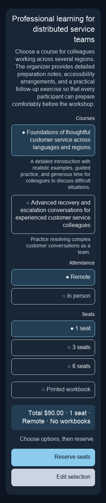
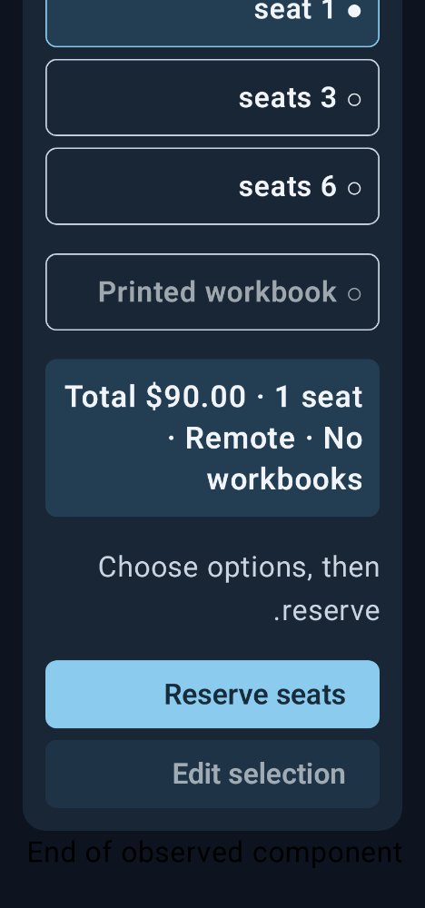
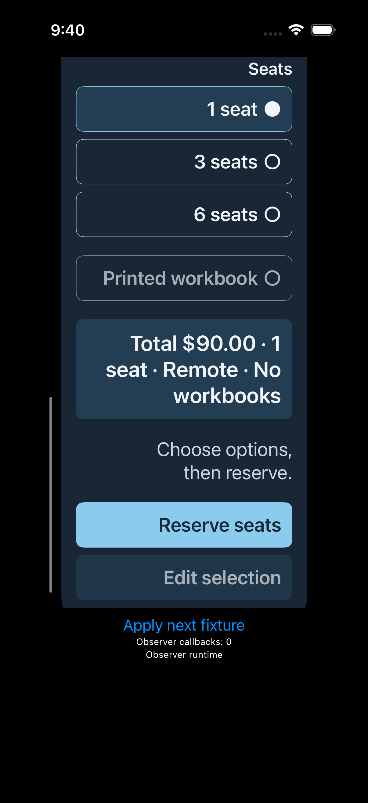
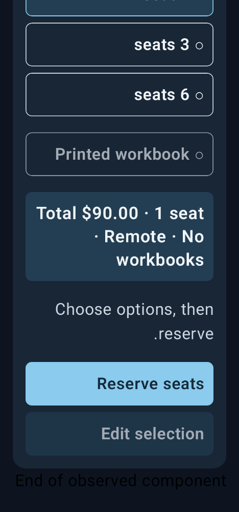

# 原始图片与修复范围

参考线框表达结构与明确标注，不与原生字体进行跨渲染器像素回归。下面链接来自共同验收逐状态证据的原始 PNG；完整滚动和其他状态仍在各 observation.json。

| 组/平台，P2 browse 的 Reserve 可见帧 | 首版 | 修复后 |
| --- | --- | --- |
| candidate-v6/ios |  |  |
| candidate-v6/android |  |  |
| baseline-v5/ios |  |  |
| baseline-v5/android |  |  |

两组 iOS 修改了显式按钮样式以回应自身原始的禁用文本可读性疑虑；它属于未定量、未确认的质性问题，不能计为已验证 F→P。新版还把 Android Reserve 最小高度改为49dp；原始48dp设计下的数值边界 F 保留，不因此声称修复了用户可见产品缺陷。

截图不证明 iOS 计算字号、颜色、框架 padding 或物理点击区域。局部可见目标不代表全页内容已完整检查。
