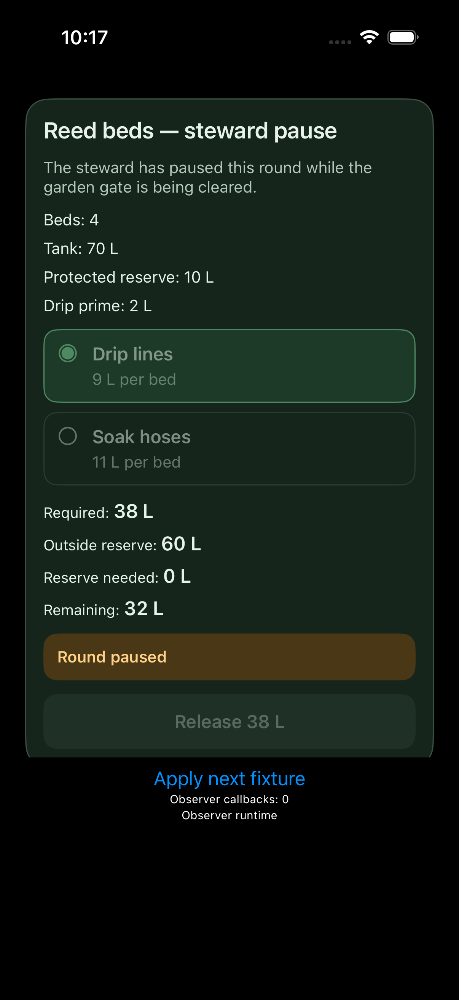
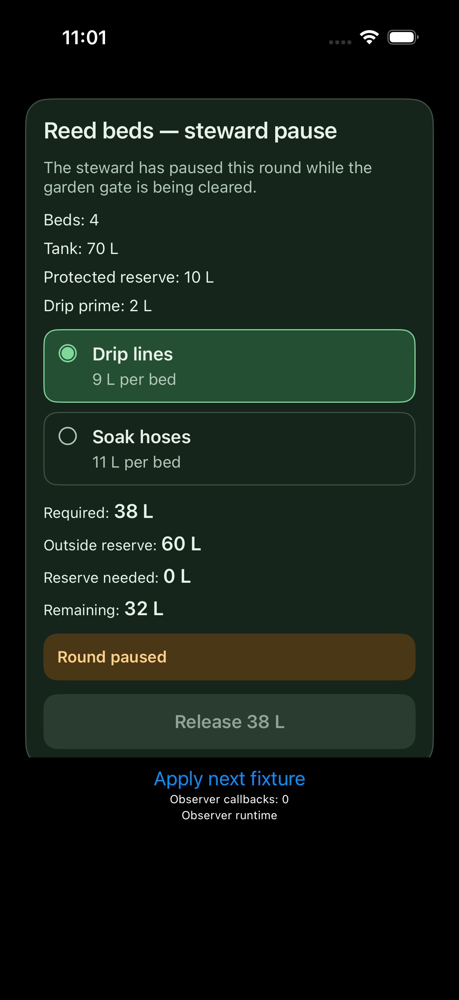
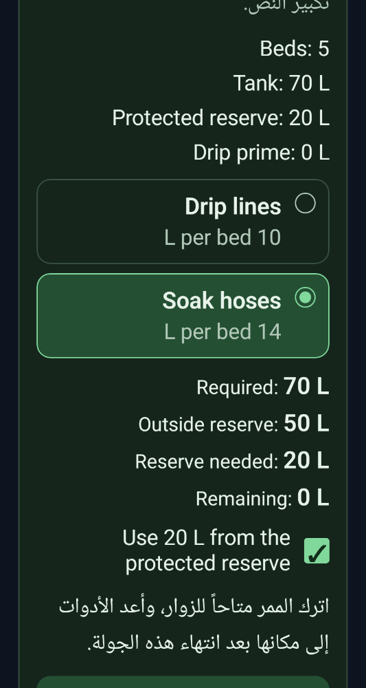
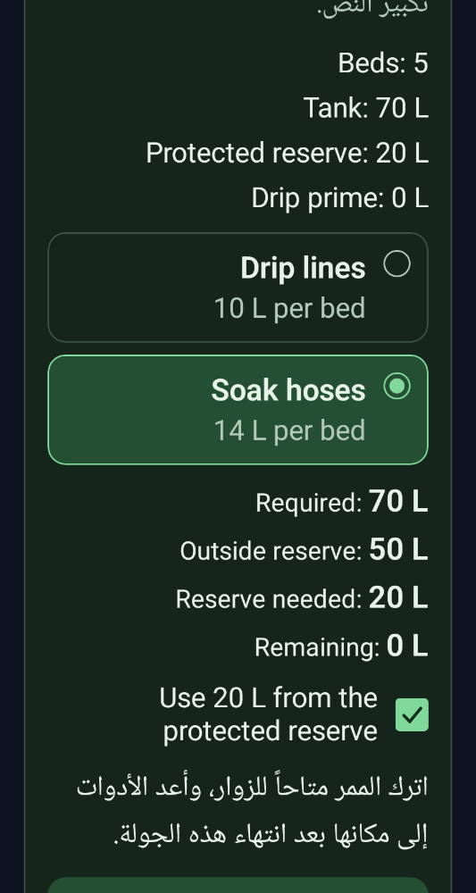
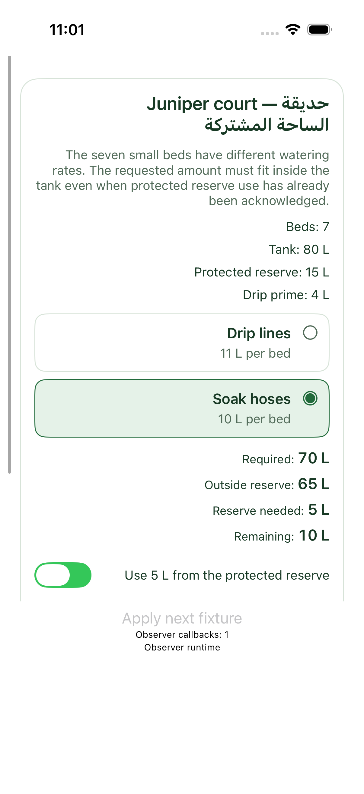

# 原始图片与保留问题

设计参考先于实现冻结：[需求](design/public/brief.md)、[API](design/public/api.md)、[独立线框](design/public/reference.svg)。线框不是原生字体像素 golden。以下均为未编辑的原始截图，链接目录保留同状态全部相邻帧；小图与 AX 不能证明实际字号、padding 或物理点击区域。

## iOS：禁用样式被额外调暗

candidate-v4 首版的深色禁用按钮经过系统 ButtonStyle 二次淡化；一次源码修复改为保留显式 palette 的样式。冻结原子行 `ios/C04/initial/style.color.submit.fill` 为 F→P：三个填色采样点从 RGB `(31,49,38)` 变为设计要求 `(41,60,47)`。其它样式方面和全状态分开评分。

| D0 原图 | FINAL 同状态完整内容原图 |
| --- | --- |
|  |  |

原评分的局部颜色采样引用同状态另一张原图 `60B85301…png`；它与上方 `CA9C9A43…png` 的原始 SHA-256 完全相同。一次多图预览把相同字节显示得不同，最初怀疑的采集器空白帧已被撤回。原始哈希/Pillow 检查及更正见 [排查记录](harness-failures/image-preview-discrepancy.json)，不计为产品或采集器缺陷。局部颜色 P 仍不等于所有样式方面都通过。

## Android：图像修正与原生 label 修正是两种证据

C02 RTL 文字的 `L per bed 10` 修正为 `10 L per bed`。保护用水确认控件的装饰勾号改用非 Text 绘制，并显式提供语义名称。图能看见文字方向变化；**图不能证明 AX label**。原生 `android/C02/a03/consent.text` 从 `✓, Use 20 L from the protected reserve` 变为 `Use 20 L from the protected reserve`，冻结评分 F→P。

| D0 原图 | FINAL 原图 |
| --- | --- |
|  |  |

这一个语义标签共因影响 C02/C03 的八个动作后状态。自查只明确报告其中两项，另外六项仍计漏检；同一修复使八项通过，不反向给六项检出信用。

## iOS 保留场景：可见 AX 控件高度缺口

`ios/H01/a03/layout.consent.minVisibleHeight` 原生可见边界为 28 pt，冻结要求为至少 44 pt，最终为 F。它不在开发者看到的四场景内，保留场景执行后没有再次修改代码；该边界也不是系统物理 hit region。

原始评分：[D0](design/private/evaluation/d0/sample-716d41/grade.json)、[FINAL](design/private/evaluation/final/sample-716d41/grade.json)；全部失败、浮点边界及未评估详见 [FAILURES.md](FAILURES.md)。
