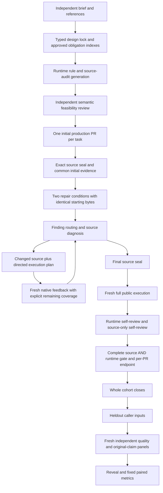

# Decision and feedback execution

The runtime plan carries the independently approved actions, after-targets and
coverage. A diagnostic prefix keeps original action indices and caller transitions.
A full-content state supplies overlapping new native packets for its entire logical
content. Target-only states carry their exact observed scope. Original image bytes,
source version, input, process and event epoch remain bound to every result.

On iOS, coalescing reuses the complete state sweep's fresh AX/image packet for its
own target observations and skips auxiliary unrequested scans. Activation keeps
its unique-control and successful-dispatch path. Android uses the same independent
plan with its existing Paparazzi/semantics collector. Every code version gets new
native evidence; compile caching concerns compiled output only.

Source-only contracts use a separate exact-file/line review catalog. Source and
rendered facts stay distinct through the final gate and external assessment. The
source supplement is shared by both conditions. The source-API availability check
emits the actual Swift module and checks its unchanged caller at the declared OS
API; linking/archive/older-runtime coverage is separately stated.

The orchestration starts each unit's full final verification immediately after its
own source closes. Research isolation waits apply before heldout/external feedback,
not to its earlier public verification endpoint. All queues and consumer review
spans are recorded. Detection, repair, newly introduced failures, unknowns and cost
use the same initial source population and fixed methods.
