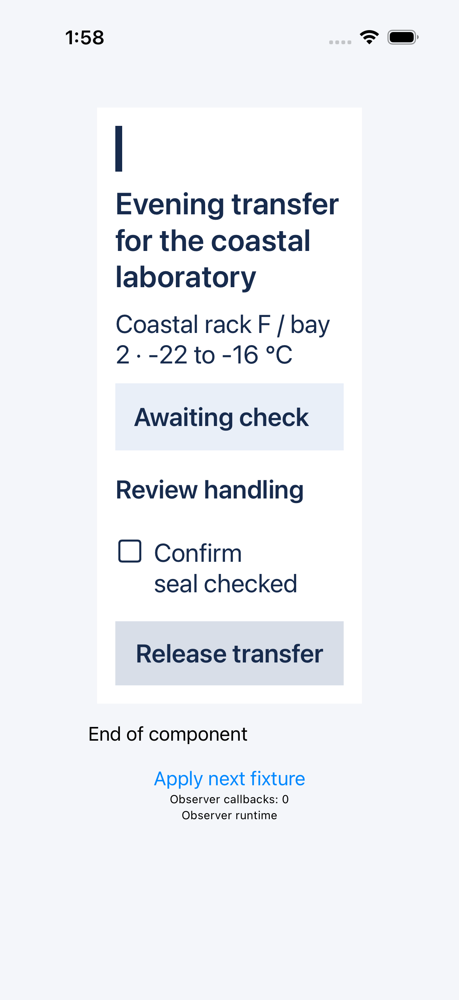
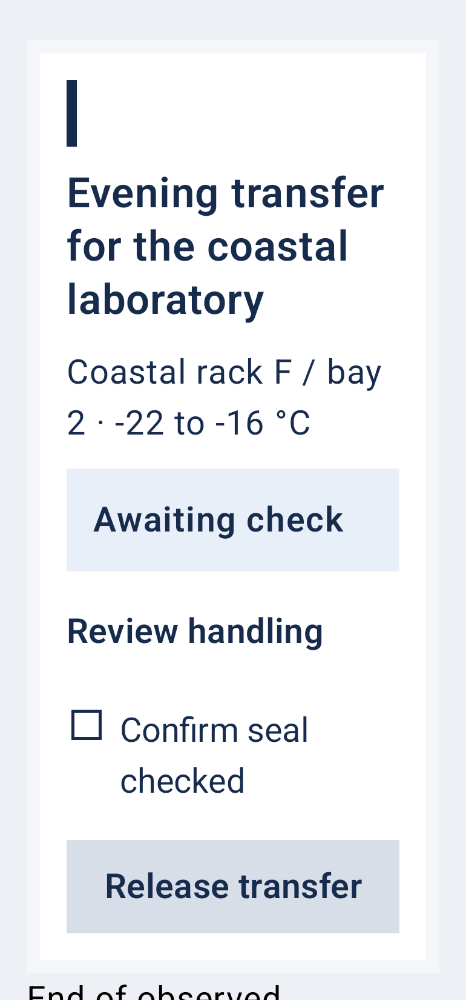
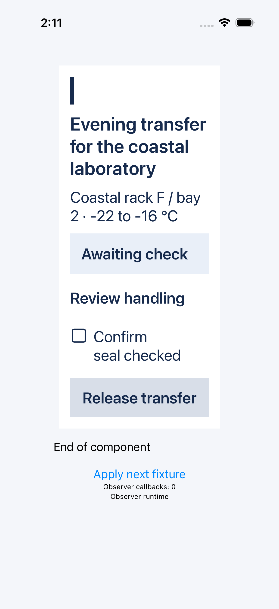
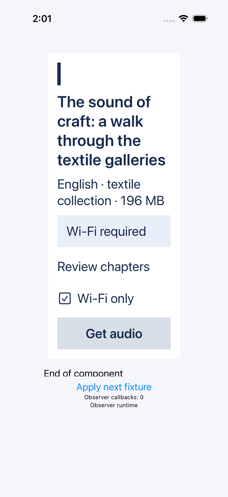
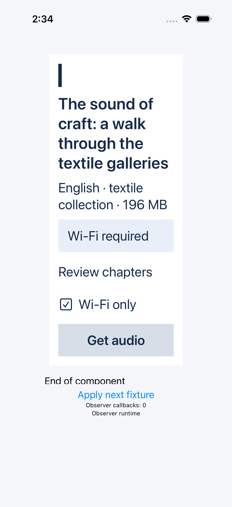
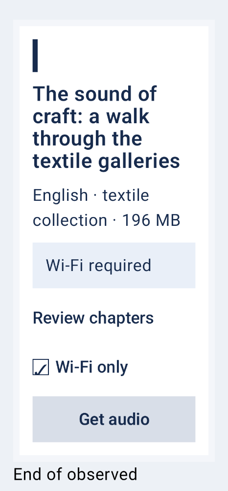

# 原始界面与逐状态采集

全部图片为原采集字节；本页不重画、修图或重新渲染。完整来源、覆盖与输入/事件绑定见同目录 observation.json。长内容须检查整个状态的图集，首末图片链接不是完整覆盖的替代。

## T1 / 相同初始 PR / ios / P1

[原始观测](corpora/T1/d0/ios/P1/native/observation.json)

| 状态 | 原始快照索引 | 首帧 | 末帧 | 完整覆盖 |
| --- | --- | --- | --- | --- |
| overview | 2 | [图 2](corpora/T1/d0/ios/P1/native/attachments/EEE60992-08ED-43EE-8FC7-F8023D8FE68B.png) | [图 2](corpora/T1/d0/ios/P1/native/attachments/EEE60992-08ED-43EE-8FC7-F8023D8FE68B.png) | True |
| permitted | 13, 14, 15, 16, 17, 18 | [图 13](corpora/T1/d0/ios/P1/native/attachments/13B5328A-194E-4020-ADE5-E341AF27A4E0.png) | [图 18](corpora/T1/d0/ios/P1/native/attachments/73670CC2-559D-4E5A-A70D-08A507A7F872.png) | True |
| requested | 34, 35, 36, 37, 38, 39 | [图 34](corpora/T1/d0/ios/P1/native/attachments/4CEB4F03-B48D-4ECC-B44F-73C2019D53C8.png) | [图 39](corpora/T1/d0/ios/P1/native/attachments/51C6F71C-E186-46B1-A3D6-687352318E24.png) | True |
| requested-closed | 44 | [图 44](corpora/T1/d0/ios/P1/native/attachments/028B43F9-8945-4187-A2D0-FA4E3AB5A4E5.png) | [图 44](corpora/T1/d0/ios/P1/native/attachments/028B43F9-8945-4187-A2D0-FA4E3AB5A4E5.png) | True |
| replaced | 49 | [图 49](corpora/T1/d0/ios/P1/native/attachments/51224766-C296-4376-AD1D-9430498CEF03.png) | [图 49](corpora/T1/d0/ios/P1/native/attachments/51224766-C296-4376-AD1D-9430498CEF03.png) | True |

## T1 / 相同初始 PR / ios / P2

[原始观测](corpora/T1/d0/ios/P2/native/observation.json)

| 状态 | 原始快照索引 | 首帧 | 末帧 | 完整覆盖 |
| --- | --- | --- | --- | --- |
| overview | 2 | [图 2](corpora/T1/d0/ios/P2/native/attachments/97F04014-6852-420F-8320-7BB8C6757E08.png) | [图 2](corpora/T1/d0/ios/P2/native/attachments/97F04014-6852-420F-8320-7BB8C6757E08.png) | True |
| permitted | 16, 17, 18, 19, 20, 21, 22, 23, 24, 25, 26 | [图 16](corpora/T1/d0/ios/P2/native/attachments/88C9A6A5-36D6-442D-B79D-8CE3764F99D3.png) | [图 26](corpora/T1/d0/ios/P2/native/attachments/7E3B4F4D-336F-4551-B51C-29F11C213348.png) | True |
| requested | 48, 49, 50, 51, 52, 53, 54, 55, 56, 57, 58 | [图 48](corpora/T1/d0/ios/P2/native/attachments/F153C34D-BF12-4187-BD88-37A01804FB40.png) | [图 58](corpora/T1/d0/ios/P2/native/attachments/A843427E-D754-4D01-8EDF-A7AB750C6D81.png) | True |
| requested-closed | 63, 64 | [图 63](corpora/T1/d0/ios/P2/native/attachments/09B10AB3-FE70-46B2-A833-17CEA9A175FA.png) | [图 64](corpora/T1/d0/ios/P2/native/attachments/1C594A7F-214F-449E-AFDA-DBEF4A3FD7DE.png) | True |
| replaced | 69, 70 | [图 69](corpora/T1/d0/ios/P2/native/attachments/70926132-BF5F-40B0-A154-8556F91B541C.png) | [图 70](corpora/T1/d0/ios/P2/native/attachments/E9C7B024-9946-4A1D-B677-939A711BB2A4.png) | True |

## T1 / 相同初始 PR / android / P1

[原始观测](corpora/T1/d0/android/P1/native/observation.json)

| 状态 | 原始快照索引 | 首帧 | 末帧 | 完整覆盖 |
| --- | --- | --- | --- | --- |
| initial | 0 | [图 0](corpora/T1/d0/android/P1/native/000-state_initial_0.png) | [图 0](corpora/T1/d0/android/P1/native/000-state_initial_0.png) | True |
| overview | 1 | [图 1](corpora/T1/d0/android/P1/native/001-state_overview_0.png) | [图 1](corpora/T1/d0/android/P1/native/001-state_overview_0.png) | True |
| opened | 4, 5, 6, 7, 8, 9, 10 | [图 4](corpora/T1/d0/android/P1/native/004-state_opened_0.png) | [图 10](corpora/T1/d0/android/P1/native/010-state_opened_6.png) | True |
| permitted | 12, 13, 14, 15, 16, 17, 18 | [图 12](corpora/T1/d0/android/P1/native/012-state_permitted_0.png) | [图 18](corpora/T1/d0/android/P1/native/018-state_permitted_6.png) | True |
| cleared | 21, 22, 23, 24, 25, 26, 27 | [图 21](corpora/T1/d0/android/P1/native/021-state_cleared_0.png) | [图 27](corpora/T1/d0/android/P1/native/027-state_cleared_6.png) | True |
| restored | 30, 31, 32, 33, 34, 35, 36 | [图 30](corpora/T1/d0/android/P1/native/030-state_restored_0.png) | [图 36](corpora/T1/d0/android/P1/native/036-state_restored_6.png) | True |
| requested | 38, 39, 40, 41, 42, 43, 44 | [图 38](corpora/T1/d0/android/P1/native/038-state_requested_0.png) | [图 44](corpora/T1/d0/android/P1/native/044-state_requested_6.png) | True |
| requested-closed | 46 | [图 46](corpora/T1/d0/android/P1/native/046-state_requested-closed_0.png) | [图 46](corpora/T1/d0/android/P1/native/046-state_requested-closed_0.png) | True |
| before-update-10 | 47 | [图 47](corpora/T1/d0/android/P1/native/047-state_before-update-10_0.png) | [图 47](corpora/T1/d0/android/P1/native/047-state_before-update-10_0.png) | True |
| replaced | 49 | [图 49](corpora/T1/d0/android/P1/native/049-state_replaced_0.png) | [图 49](corpora/T1/d0/android/P1/native/049-state_replaced_0.png) | True |
| held-choice | 51 | [图 51](corpora/T1/d0/android/P1/native/051-state_held-choice_0.png) | [图 51](corpora/T1/d0/android/P1/native/051-state_held-choice_0.png) | True |
| final | 52 | [图 52](corpora/T1/d0/android/P1/native/052-state_final_0.png) | [图 52](corpora/T1/d0/android/P1/native/052-state_final_0.png) | True |

## T1 / 相同初始 PR / android / P2

[原始观测](corpora/T1/d0/android/P2/native/observation.json)

| 状态 | 原始快照索引 | 首帧 | 末帧 | 完整覆盖 |
| --- | --- | --- | --- | --- |
| initial | 0, 1 | [图 0](corpora/T1/d0/android/P2/native/000-state_initial_0.png) | [图 1](corpora/T1/d0/android/P2/native/001-state_initial_1.png) | True |
| overview | 2, 3 | [图 2](corpora/T1/d0/android/P2/native/002-state_overview_0.png) | [图 3](corpora/T1/d0/android/P2/native/003-state_overview_1.png) | True |
| opened | 6, 7, 8, 9, 10, 11, 12, 13, 14, 15, 16, 17 | [图 6](corpora/T1/d0/android/P2/native/006-state_opened_0.png) | [图 17](corpora/T1/d0/android/P2/native/017-state_opened_11.png) | True |
| permitted | 19, 20, 21, 22, 23, 24, 25, 26, 27, 28, 29, 30 | [图 19](corpora/T1/d0/android/P2/native/019-state_permitted_0.png) | [图 30](corpora/T1/d0/android/P2/native/030-state_permitted_11.png) | True |
| cleared | 33, 34, 35, 36, 37, 38, 39, 40, 41, 42, 43, 44 | [图 33](corpora/T1/d0/android/P2/native/033-state_cleared_0.png) | [图 44](corpora/T1/d0/android/P2/native/044-state_cleared_11.png) | True |
| restored | 48, 49, 50, 51, 52, 53, 54, 55, 56, 57, 58, 59 | [图 48](corpora/T1/d0/android/P2/native/048-state_restored_0.png) | [图 59](corpora/T1/d0/android/P2/native/059-state_restored_11.png) | True |
| requested | 61, 62, 63, 64, 65, 66, 67, 68, 69, 70, 71, 72 | [图 61](corpora/T1/d0/android/P2/native/061-state_requested_0.png) | [图 72](corpora/T1/d0/android/P2/native/072-state_requested_11.png) | True |
| requested-closed | 74, 75 | [图 74](corpora/T1/d0/android/P2/native/074-state_requested-closed_0.png) | [图 75](corpora/T1/d0/android/P2/native/075-state_requested-closed_1.png) | True |
| before-update-10 | 76, 77 | [图 76](corpora/T1/d0/android/P2/native/076-state_before-update-10_0.png) | [图 77](corpora/T1/d0/android/P2/native/077-state_before-update-10_1.png) | True |
| replaced | 79, 80 | [图 79](corpora/T1/d0/android/P2/native/079-state_replaced_0.png) | [图 80](corpora/T1/d0/android/P2/native/080-state_replaced_1.png) | True |
| held-choice | 82, 83 | [图 82](corpora/T1/d0/android/P2/native/082-state_held-choice_0.png) | [图 83](corpora/T1/d0/android/P2/native/083-state_held-choice_1.png) | True |
| final | 84, 85 | [图 84](corpora/T1/d0/android/P2/native/084-state_final_0.png) | [图 85](corpora/T1/d0/android/P2/native/085-state_final_1.png) | True |

## T1 / baseline-v8 / u-aad1094f / ios / P1

[原始观测](corpora/u-aad1094f/final-public/ios/P1/native/observation.json)

| 状态 | 原始快照索引 | 首帧 | 末帧 | 完整覆盖 |
| --- | --- | --- | --- | --- |
| overview | 2 | [图 2](corpora/u-aad1094f/final-public/ios/P1/native/attachments/F97C45B3-0E9B-4EFB-857B-EF35FA698A05.png) | [图 2](corpora/u-aad1094f/final-public/ios/P1/native/attachments/F97C45B3-0E9B-4EFB-857B-EF35FA698A05.png) | True |
| permitted | 13, 14, 15, 16, 17, 18 | [图 13](corpora/u-aad1094f/final-public/ios/P1/native/attachments/E4777629-10B8-4699-82B6-C8BB8C446B8E.png) | [图 18](corpora/u-aad1094f/final-public/ios/P1/native/attachments/6B989589-D509-46EE-8EC8-E90E1016BEBC.png) | True |
| requested | 34, 35, 36, 37, 38, 39 | [图 34](corpora/u-aad1094f/final-public/ios/P1/native/attachments/0E9BB83E-9F20-42F8-9904-469EE06FCCAA.png) | [图 39](corpora/u-aad1094f/final-public/ios/P1/native/attachments/8B0F3D99-A54C-4122-8327-35CEC6C28B0C.png) | True |
| requested-closed | 44 | [图 44](corpora/u-aad1094f/final-public/ios/P1/native/attachments/7615B159-373C-40CC-8B02-19E5CD813161.png) | [图 44](corpora/u-aad1094f/final-public/ios/P1/native/attachments/7615B159-373C-40CC-8B02-19E5CD813161.png) | True |
| replaced | 49 | [图 49](corpora/u-aad1094f/final-public/ios/P1/native/attachments/E96B8240-9DAD-4F97-A717-5D07512BE136.png) | [图 49](corpora/u-aad1094f/final-public/ios/P1/native/attachments/E96B8240-9DAD-4F97-A717-5D07512BE136.png) | True |

## T1 / baseline-v8 / u-aad1094f / ios / P2

[原始观测](corpora/u-aad1094f/final-public/ios/P2/native/observation.json)

| 状态 | 原始快照索引 | 首帧 | 末帧 | 完整覆盖 |
| --- | --- | --- | --- | --- |
| overview | 2 | [图 2](corpora/u-aad1094f/final-public/ios/P2/native/attachments/40291A0F-C70A-4842-9BEC-8E4D21B2EF9A.png) | [图 2](corpora/u-aad1094f/final-public/ios/P2/native/attachments/40291A0F-C70A-4842-9BEC-8E4D21B2EF9A.png) | True |
| permitted | 16, 17, 18, 19, 20, 21, 22, 23, 24, 25, 26 | [图 16](corpora/u-aad1094f/final-public/ios/P2/native/attachments/7C841C35-8CEE-4D0D-9C9C-7DE78665F210.png) | [图 26](corpora/u-aad1094f/final-public/ios/P2/native/attachments/57A8AC3B-47B0-42AA-8F0E-AC20ACF5C589.png) | True |
| requested | 48, 49, 50, 51, 52, 53, 54, 55, 56, 57, 58 | [图 48](corpora/u-aad1094f/final-public/ios/P2/native/attachments/02E42712-F8A9-46B9-AE6C-EA935B922A47.png) | [图 58](corpora/u-aad1094f/final-public/ios/P2/native/attachments/7458202A-44BF-41AD-B00B-E8AF7DF252CF.png) | True |
| requested-closed | 63, 64 | [图 63](corpora/u-aad1094f/final-public/ios/P2/native/attachments/12CB9A0C-85BB-47BD-85E0-F341F63403EA.png) | [图 64](corpora/u-aad1094f/final-public/ios/P2/native/attachments/F6A56BDD-0DB0-45A5-8276-63E50F10D840.png) | True |
| replaced | 69, 70 | [图 69](corpora/u-aad1094f/final-public/ios/P2/native/attachments/76CD7CC8-EB39-4F98-A8E2-1ABBAC5ACC4D.png) | [图 70](corpora/u-aad1094f/final-public/ios/P2/native/attachments/15E1E42B-E274-40EE-AD00-1820C383346C.png) | True |

## T1 / baseline-v8 / u-aad1094f / android / P1

[原始观测](corpora/u-aad1094f/final-public/android/P1/native/observation.json)

| 状态 | 原始快照索引 | 首帧 | 末帧 | 完整覆盖 |
| --- | --- | --- | --- | --- |
| initial | 0 | [图 0](corpora/u-aad1094f/final-public/android/P1/native/000-state_initial_0.png) | [图 0](corpora/u-aad1094f/final-public/android/P1/native/000-state_initial_0.png) | True |
| overview | 1 | [图 1](corpora/u-aad1094f/final-public/android/P1/native/001-state_overview_0.png) | [图 1](corpora/u-aad1094f/final-public/android/P1/native/001-state_overview_0.png) | True |
| opened | 4, 5, 6, 7, 8, 9, 10 | [图 4](corpora/u-aad1094f/final-public/android/P1/native/004-state_opened_0.png) | [图 10](corpora/u-aad1094f/final-public/android/P1/native/010-state_opened_6.png) | True |
| permitted | 12, 13, 14, 15, 16, 17, 18 | [图 12](corpora/u-aad1094f/final-public/android/P1/native/012-state_permitted_0.png) | [图 18](corpora/u-aad1094f/final-public/android/P1/native/018-state_permitted_6.png) | True |
| cleared | 21, 22, 23, 24, 25, 26, 27 | [图 21](corpora/u-aad1094f/final-public/android/P1/native/021-state_cleared_0.png) | [图 27](corpora/u-aad1094f/final-public/android/P1/native/027-state_cleared_6.png) | True |
| restored | 30, 31, 32, 33, 34, 35, 36 | [图 30](corpora/u-aad1094f/final-public/android/P1/native/030-state_restored_0.png) | [图 36](corpora/u-aad1094f/final-public/android/P1/native/036-state_restored_6.png) | True |
| requested | 38, 39, 40, 41, 42, 43, 44 | [图 38](corpora/u-aad1094f/final-public/android/P1/native/038-state_requested_0.png) | [图 44](corpora/u-aad1094f/final-public/android/P1/native/044-state_requested_6.png) | True |
| requested-closed | 46 | [图 46](corpora/u-aad1094f/final-public/android/P1/native/046-state_requested-closed_0.png) | [图 46](corpora/u-aad1094f/final-public/android/P1/native/046-state_requested-closed_0.png) | True |
| before-update-10 | 47 | [图 47](corpora/u-aad1094f/final-public/android/P1/native/047-state_before-update-10_0.png) | [图 47](corpora/u-aad1094f/final-public/android/P1/native/047-state_before-update-10_0.png) | True |
| replaced | 49 | [图 49](corpora/u-aad1094f/final-public/android/P1/native/049-state_replaced_0.png) | [图 49](corpora/u-aad1094f/final-public/android/P1/native/049-state_replaced_0.png) | True |
| held-choice | 51 | [图 51](corpora/u-aad1094f/final-public/android/P1/native/051-state_held-choice_0.png) | [图 51](corpora/u-aad1094f/final-public/android/P1/native/051-state_held-choice_0.png) | True |
| final | 52 | [图 52](corpora/u-aad1094f/final-public/android/P1/native/052-state_final_0.png) | [图 52](corpora/u-aad1094f/final-public/android/P1/native/052-state_final_0.png) | True |

## T1 / baseline-v8 / u-aad1094f / android / P2

[原始观测](corpora/u-aad1094f/final-public/android/P2/native/observation.json)

| 状态 | 原始快照索引 | 首帧 | 末帧 | 完整覆盖 |
| --- | --- | --- | --- | --- |
| initial | 0, 1 | [图 0](corpora/u-aad1094f/final-public/android/P2/native/000-state_initial_0.png) | [图 1](corpora/u-aad1094f/final-public/android/P2/native/001-state_initial_1.png) | True |
| overview | 2, 3 | [图 2](corpora/u-aad1094f/final-public/android/P2/native/002-state_overview_0.png) | [图 3](corpora/u-aad1094f/final-public/android/P2/native/003-state_overview_1.png) | True |
| opened | 6, 7, 8, 9, 10, 11, 12, 13, 14, 15, 16, 17 | [图 6](corpora/u-aad1094f/final-public/android/P2/native/006-state_opened_0.png) | [图 17](corpora/u-aad1094f/final-public/android/P2/native/017-state_opened_11.png) | True |
| permitted | 19, 20, 21, 22, 23, 24, 25, 26, 27, 28, 29, 30 | [图 19](corpora/u-aad1094f/final-public/android/P2/native/019-state_permitted_0.png) | [图 30](corpora/u-aad1094f/final-public/android/P2/native/030-state_permitted_11.png) | True |
| cleared | 33, 34, 35, 36, 37, 38, 39, 40, 41, 42, 43, 44 | [图 33](corpora/u-aad1094f/final-public/android/P2/native/033-state_cleared_0.png) | [图 44](corpora/u-aad1094f/final-public/android/P2/native/044-state_cleared_11.png) | True |
| restored | 48, 49, 50, 51, 52, 53, 54, 55, 56, 57, 58, 59 | [图 48](corpora/u-aad1094f/final-public/android/P2/native/048-state_restored_0.png) | [图 59](corpora/u-aad1094f/final-public/android/P2/native/059-state_restored_11.png) | True |
| requested | 61, 62, 63, 64, 65, 66, 67, 68, 69, 70, 71, 72 | [图 61](corpora/u-aad1094f/final-public/android/P2/native/061-state_requested_0.png) | [图 72](corpora/u-aad1094f/final-public/android/P2/native/072-state_requested_11.png) | True |
| requested-closed | 74, 75 | [图 74](corpora/u-aad1094f/final-public/android/P2/native/074-state_requested-closed_0.png) | [图 75](corpora/u-aad1094f/final-public/android/P2/native/075-state_requested-closed_1.png) | True |
| before-update-10 | 76, 77 | [图 76](corpora/u-aad1094f/final-public/android/P2/native/076-state_before-update-10_0.png) | [图 77](corpora/u-aad1094f/final-public/android/P2/native/077-state_before-update-10_1.png) | True |
| replaced | 79, 80 | [图 79](corpora/u-aad1094f/final-public/android/P2/native/079-state_replaced_0.png) | [图 80](corpora/u-aad1094f/final-public/android/P2/native/080-state_replaced_1.png) | True |
| held-choice | 82, 83 | [图 82](corpora/u-aad1094f/final-public/android/P2/native/082-state_held-choice_0.png) | [图 83](corpora/u-aad1094f/final-public/android/P2/native/083-state_held-choice_1.png) | True |
| final | 84, 85 | [图 84](corpora/u-aad1094f/final-public/android/P2/native/084-state_final_0.png) | [图 85](corpora/u-aad1094f/final-public/android/P2/native/085-state_final_1.png) | True |

## T1 / candidate-v9 / u-bafc7f84 / ios / P1

[原始观测](corpora/u-bafc7f84/final-public/ios/P1/native/observation.json)

| 状态 | 原始快照索引 | 首帧 | 末帧 | 完整覆盖 |
| --- | --- | --- | --- | --- |
| overview | 2 | [图 2](corpora/u-bafc7f84/final-public/ios/P1/native/attachments/0C289A1C-5275-4002-A7DE-1EDF0B7F8099.png) | [图 2](corpora/u-bafc7f84/final-public/ios/P1/native/attachments/0C289A1C-5275-4002-A7DE-1EDF0B7F8099.png) | True |
| permitted | 13, 14, 15, 16, 17, 18 | [图 13](corpora/u-bafc7f84/final-public/ios/P1/native/attachments/9D881EE2-2329-4003-AA3B-F3EBDFFF9B44.png) | [图 18](corpora/u-bafc7f84/final-public/ios/P1/native/attachments/B53B37FF-F048-4D56-A2E6-232BEAD7E50F.png) | True |
| requested | 34, 35, 36, 37, 38, 39 | [图 34](corpora/u-bafc7f84/final-public/ios/P1/native/attachments/BAA66B11-2121-488B-AA35-A4D9EC11DAF2.png) | [图 39](corpora/u-bafc7f84/final-public/ios/P1/native/attachments/CBEBCDB2-D9AA-482C-9CCA-05EE964A91AA.png) | True |
| requested-closed | 44 | [图 44](corpora/u-bafc7f84/final-public/ios/P1/native/attachments/E67F1F14-7A61-4448-9161-3F966FB7446E.png) | [图 44](corpora/u-bafc7f84/final-public/ios/P1/native/attachments/E67F1F14-7A61-4448-9161-3F966FB7446E.png) | True |
| replaced | 49 | [图 49](corpora/u-bafc7f84/final-public/ios/P1/native/attachments/B3C5C38A-3097-4CA6-A98A-3A4FCE4D063C.png) | [图 49](corpora/u-bafc7f84/final-public/ios/P1/native/attachments/B3C5C38A-3097-4CA6-A98A-3A4FCE4D063C.png) | True |

## T1 / candidate-v9 / u-bafc7f84 / ios / P2

[原始观测](corpora/u-bafc7f84/final-public/ios/P2/native/observation.json)

| 状态 | 原始快照索引 | 首帧 | 末帧 | 完整覆盖 |
| --- | --- | --- | --- | --- |
| overview | 2 | [图 2](corpora/u-bafc7f84/final-public/ios/P2/native/attachments/36D72F10-2A75-42B4-9C3C-D05DF3F0C740.png) | [图 2](corpora/u-bafc7f84/final-public/ios/P2/native/attachments/36D72F10-2A75-42B4-9C3C-D05DF3F0C740.png) | True |
| permitted | 16, 17, 18, 19, 20, 21, 22, 23, 24, 25, 26 | [图 16](corpora/u-bafc7f84/final-public/ios/P2/native/attachments/7656BF72-F592-4F75-82E0-6746A4DB3B29.png) | [图 26](corpora/u-bafc7f84/final-public/ios/P2/native/attachments/38619893-5043-4DCE-B09D-A5B69AD11679.png) | True |
| requested | 48, 49, 50, 51, 52, 53, 54, 55, 56, 57, 58 | [图 48](corpora/u-bafc7f84/final-public/ios/P2/native/attachments/CC5539C6-23FC-44CC-8FC7-1E541946D67A.png) | [图 58](corpora/u-bafc7f84/final-public/ios/P2/native/attachments/FC46D370-4F72-460A-94FA-EDD6DD663BDA.png) | True |
| requested-closed | 63, 64 | [图 63](corpora/u-bafc7f84/final-public/ios/P2/native/attachments/B048F046-D228-4196-8CB7-1CE3B8C3A81F.png) | [图 64](corpora/u-bafc7f84/final-public/ios/P2/native/attachments/7E9CE82A-DB6B-4900-BB74-863139EF279F.png) | True |
| replaced | 69, 70 | [图 69](corpora/u-bafc7f84/final-public/ios/P2/native/attachments/9EA12635-C4CD-4842-A36E-D115B3140BB6.png) | [图 70](corpora/u-bafc7f84/final-public/ios/P2/native/attachments/E029D1C2-6556-48C8-85D0-43CFC04B04D3.png) | True |

## T1 / candidate-v9 / u-bafc7f84 / android / P1

[原始观测](corpora/u-bafc7f84/final-public/android/P1/native/observation.json)

| 状态 | 原始快照索引 | 首帧 | 末帧 | 完整覆盖 |
| --- | --- | --- | --- | --- |
| initial | 0 | [图 0](corpora/u-bafc7f84/final-public/android/P1/native/000-state_initial_0.png) | [图 0](corpora/u-bafc7f84/final-public/android/P1/native/000-state_initial_0.png) | True |
| overview | 1 | [图 1](corpora/u-bafc7f84/final-public/android/P1/native/001-state_overview_0.png) | [图 1](corpora/u-bafc7f84/final-public/android/P1/native/001-state_overview_0.png) | True |
| opened | 4, 5, 6, 7, 8, 9, 10 | [图 4](corpora/u-bafc7f84/final-public/android/P1/native/004-state_opened_0.png) | [图 10](corpora/u-bafc7f84/final-public/android/P1/native/010-state_opened_6.png) | True |
| permitted | 12, 13, 14, 15, 16, 17, 18 | [图 12](corpora/u-bafc7f84/final-public/android/P1/native/012-state_permitted_0.png) | [图 18](corpora/u-bafc7f84/final-public/android/P1/native/018-state_permitted_6.png) | True |
| cleared | 21, 22, 23, 24, 25, 26, 27 | [图 21](corpora/u-bafc7f84/final-public/android/P1/native/021-state_cleared_0.png) | [图 27](corpora/u-bafc7f84/final-public/android/P1/native/027-state_cleared_6.png) | True |
| restored | 30, 31, 32, 33, 34, 35, 36 | [图 30](corpora/u-bafc7f84/final-public/android/P1/native/030-state_restored_0.png) | [图 36](corpora/u-bafc7f84/final-public/android/P1/native/036-state_restored_6.png) | True |
| requested | 38, 39, 40, 41, 42, 43, 44 | [图 38](corpora/u-bafc7f84/final-public/android/P1/native/038-state_requested_0.png) | [图 44](corpora/u-bafc7f84/final-public/android/P1/native/044-state_requested_6.png) | True |
| requested-closed | 46 | [图 46](corpora/u-bafc7f84/final-public/android/P1/native/046-state_requested-closed_0.png) | [图 46](corpora/u-bafc7f84/final-public/android/P1/native/046-state_requested-closed_0.png) | True |
| before-update-10 | 47 | [图 47](corpora/u-bafc7f84/final-public/android/P1/native/047-state_before-update-10_0.png) | [图 47](corpora/u-bafc7f84/final-public/android/P1/native/047-state_before-update-10_0.png) | True |
| replaced | 49 | [图 49](corpora/u-bafc7f84/final-public/android/P1/native/049-state_replaced_0.png) | [图 49](corpora/u-bafc7f84/final-public/android/P1/native/049-state_replaced_0.png) | True |
| held-choice | 51 | [图 51](corpora/u-bafc7f84/final-public/android/P1/native/051-state_held-choice_0.png) | [图 51](corpora/u-bafc7f84/final-public/android/P1/native/051-state_held-choice_0.png) | True |
| final | 52 | [图 52](corpora/u-bafc7f84/final-public/android/P1/native/052-state_final_0.png) | [图 52](corpora/u-bafc7f84/final-public/android/P1/native/052-state_final_0.png) | True |

## T1 / candidate-v9 / u-bafc7f84 / android / P2

[原始观测](corpora/u-bafc7f84/final-public/android/P2/native/observation.json)

| 状态 | 原始快照索引 | 首帧 | 末帧 | 完整覆盖 |
| --- | --- | --- | --- | --- |
| initial | 0, 1 | [图 0](corpora/u-bafc7f84/final-public/android/P2/native/000-state_initial_0.png) | [图 1](corpora/u-bafc7f84/final-public/android/P2/native/001-state_initial_1.png) | True |
| overview | 2, 3 | [图 2](corpora/u-bafc7f84/final-public/android/P2/native/002-state_overview_0.png) | [图 3](corpora/u-bafc7f84/final-public/android/P2/native/003-state_overview_1.png) | True |
| opened | 6, 7, 8, 9, 10, 11, 12, 13, 14, 15, 16, 17 | [图 6](corpora/u-bafc7f84/final-public/android/P2/native/006-state_opened_0.png) | [图 17](corpora/u-bafc7f84/final-public/android/P2/native/017-state_opened_11.png) | True |
| permitted | 19, 20, 21, 22, 23, 24, 25, 26, 27, 28, 29, 30 | [图 19](corpora/u-bafc7f84/final-public/android/P2/native/019-state_permitted_0.png) | [图 30](corpora/u-bafc7f84/final-public/android/P2/native/030-state_permitted_11.png) | True |
| cleared | 33, 34, 35, 36, 37, 38, 39, 40, 41, 42, 43, 44 | [图 33](corpora/u-bafc7f84/final-public/android/P2/native/033-state_cleared_0.png) | [图 44](corpora/u-bafc7f84/final-public/android/P2/native/044-state_cleared_11.png) | True |
| restored | 48, 49, 50, 51, 52, 53, 54, 55, 56, 57, 58, 59 | [图 48](corpora/u-bafc7f84/final-public/android/P2/native/048-state_restored_0.png) | [图 59](corpora/u-bafc7f84/final-public/android/P2/native/059-state_restored_11.png) | True |
| requested | 61, 62, 63, 64, 65, 66, 67, 68, 69, 70, 71, 72 | [图 61](corpora/u-bafc7f84/final-public/android/P2/native/061-state_requested_0.png) | [图 72](corpora/u-bafc7f84/final-public/android/P2/native/072-state_requested_11.png) | True |
| requested-closed | 74, 75 | [图 74](corpora/u-bafc7f84/final-public/android/P2/native/074-state_requested-closed_0.png) | [图 75](corpora/u-bafc7f84/final-public/android/P2/native/075-state_requested-closed_1.png) | True |
| before-update-10 | 76, 77 | [图 76](corpora/u-bafc7f84/final-public/android/P2/native/076-state_before-update-10_0.png) | [图 77](corpora/u-bafc7f84/final-public/android/P2/native/077-state_before-update-10_1.png) | True |
| replaced | 79, 80 | [图 79](corpora/u-bafc7f84/final-public/android/P2/native/079-state_replaced_0.png) | [图 80](corpora/u-bafc7f84/final-public/android/P2/native/080-state_replaced_1.png) | True |
| held-choice | 82, 83 | [图 82](corpora/u-bafc7f84/final-public/android/P2/native/082-state_held-choice_0.png) | [图 83](corpora/u-bafc7f84/final-public/android/P2/native/083-state_held-choice_1.png) | True |
| final | 84, 85 | [图 84](corpora/u-bafc7f84/final-public/android/P2/native/084-state_final_0.png) | [图 85](corpora/u-bafc7f84/final-public/android/P2/native/085-state_final_1.png) | True |

## T2 / 相同初始 PR / ios / P1

[原始观测](corpora/T2/d0/ios/P1/native/observation.json)

| 状态 | 原始快照索引 | 首帧 | 末帧 | 完整覆盖 |
| --- | --- | --- | --- | --- |
| overview | 2 | [图 2](corpora/T2/d0/ios/P1/native/attachments/C930A972-08F1-4C8B-970E-74F315EAB338.png) | [图 2](corpora/T2/d0/ios/P1/native/attachments/C930A972-08F1-4C8B-970E-74F315EAB338.png) | True |
| permitted | 13, 14, 15, 16, 17, 18, 19 | [图 13](corpora/T2/d0/ios/P1/native/attachments/C5F70288-9F6C-4134-8878-E4A7CDD525C2.png) | [图 19](corpora/T2/d0/ios/P1/native/attachments/C25C589A-88D6-4270-8621-25E6CBF84A6D.png) | True |
| requested | 36, 37, 38, 39, 40, 41, 42 | [图 36](corpora/T2/d0/ios/P1/native/attachments/E4E12536-EE7C-4CBE-9DCC-6729D5E139CE.png) | [图 42](corpora/T2/d0/ios/P1/native/attachments/FFDDECC3-0E94-4E5E-8459-30F8E9A48C9F.png) | True |
| requested-closed | 47 | [图 47](corpora/T2/d0/ios/P1/native/attachments/0E41BFCE-6D58-4DF1-BEFB-16AA7F2424ED.png) | [图 47](corpora/T2/d0/ios/P1/native/attachments/0E41BFCE-6D58-4DF1-BEFB-16AA7F2424ED.png) | True |
| replaced | 52 | [图 52](corpora/T2/d0/ios/P1/native/attachments/C9356E06-F73A-49DC-96D6-529EA7D2876A.png) | [图 52](corpora/T2/d0/ios/P1/native/attachments/C9356E06-F73A-49DC-96D6-529EA7D2876A.png) | True |

## T2 / 相同初始 PR / ios / P2

[原始观测](corpora/T2/d0/ios/P2/native/observation.json)

| 状态 | 原始快照索引 | 首帧 | 末帧 | 完整覆盖 |
| --- | --- | --- | --- | --- |
| overview | 2, 3 | [图 2](corpora/T2/d0/ios/P2/native/attachments/9E32459D-40F2-4758-A242-8E0F29577847.png) | [图 3](corpora/T2/d0/ios/P2/native/attachments/0E65E976-3E0F-45A4-81E3-13B249EA50E7.png) | True |
| permitted | 17, 18, 19, 20, 21, 22, 23, 24, 25, 26, 27, 28 | [图 17](corpora/T2/d0/ios/P2/native/attachments/22D5ECAA-BFD7-4E96-808C-0F579213DDCA.png) | [图 28](corpora/T2/d0/ios/P2/native/attachments/EF708C48-DAC5-42C1-89DA-F6F55C1D988A.png) | True |
| requested | 51, 52, 53, 54, 55, 56, 57, 58, 59, 60, 61, 62 | [图 51](corpora/T2/d0/ios/P2/native/attachments/2820B93C-AE74-4B73-B91B-0BBEF7B42730.png) | [图 62](corpora/T2/d0/ios/P2/native/attachments/AA6C3BEA-F1B1-4B19-8DFF-C0A51149DC62.png) | True |
| requested-closed | 67, 68 | [图 67](corpora/T2/d0/ios/P2/native/attachments/2A3C9A3A-8DBC-4D32-90D7-0E361E426E6F.png) | [图 68](corpora/T2/d0/ios/P2/native/attachments/CCC3EAA4-DF10-424D-885A-9AC0AEF21CD6.png) | True |
| replaced | 73, 74 | [图 73](corpora/T2/d0/ios/P2/native/attachments/78E4056B-B3FA-409D-A5B0-8897E1169D62.png) | [图 74](corpora/T2/d0/ios/P2/native/attachments/888967C4-42E1-4A2A-A5EE-5A8481D6FF85.png) | True |

## T2 / 相同初始 PR / android / P1

[原始观测](corpora/T2/d0/android/P1/native/observation.json)

| 状态 | 原始快照索引 | 首帧 | 末帧 | 完整覆盖 |
| --- | --- | --- | --- | --- |
| initial | 0 | [图 0](corpora/T2/d0/android/P1/native/000-state_initial_0.png) | [图 0](corpora/T2/d0/android/P1/native/000-state_initial_0.png) | True |
| overview | 1 | [图 1](corpora/T2/d0/android/P1/native/001-state_overview_0.png) | [图 1](corpora/T2/d0/android/P1/native/001-state_overview_0.png) | True |
| opened | 4, 5, 6, 7, 8, 9, 10 | [图 4](corpora/T2/d0/android/P1/native/004-state_opened_0.png) | [图 10](corpora/T2/d0/android/P1/native/010-state_opened_6.png) | True |
| permitted | 12, 13, 14, 15, 16, 17, 18 | [图 12](corpora/T2/d0/android/P1/native/012-state_permitted_0.png) | [图 18](corpora/T2/d0/android/P1/native/018-state_permitted_6.png) | True |
| cleared | 21, 22, 23, 24, 25, 26, 27 | [图 21](corpora/T2/d0/android/P1/native/021-state_cleared_0.png) | [图 27](corpora/T2/d0/android/P1/native/027-state_cleared_6.png) | True |
| restored | 30, 31, 32, 33, 34, 35, 36 | [图 30](corpora/T2/d0/android/P1/native/030-state_restored_0.png) | [图 36](corpora/T2/d0/android/P1/native/036-state_restored_6.png) | True |
| requested | 38, 39, 40, 41, 42, 43, 44 | [图 38](corpora/T2/d0/android/P1/native/038-state_requested_0.png) | [图 44](corpora/T2/d0/android/P1/native/044-state_requested_6.png) | True |
| requested-closed | 46 | [图 46](corpora/T2/d0/android/P1/native/046-state_requested-closed_0.png) | [图 46](corpora/T2/d0/android/P1/native/046-state_requested-closed_0.png) | True |
| before-update-10 | 47 | [图 47](corpora/T2/d0/android/P1/native/047-state_before-update-10_0.png) | [图 47](corpora/T2/d0/android/P1/native/047-state_before-update-10_0.png) | True |
| replaced | 49 | [图 49](corpora/T2/d0/android/P1/native/049-state_replaced_0.png) | [图 49](corpora/T2/d0/android/P1/native/049-state_replaced_0.png) | True |
| held-choice | 51 | [图 51](corpora/T2/d0/android/P1/native/051-state_held-choice_0.png) | [图 51](corpora/T2/d0/android/P1/native/051-state_held-choice_0.png) | True |
| before-update-13 | 52 | [图 52](corpora/T2/d0/android/P1/native/052-state_before-update-13_0.png) | [图 52](corpora/T2/d0/android/P1/native/052-state_before-update-13_0.png) | True |
| competing-gates | 54 | [图 54](corpora/T2/d0/android/P1/native/054-state_competing-gates_0.png) | [图 54](corpora/T2/d0/android/P1/native/054-state_competing-gates_0.png) | True |
| final | 55 | [图 55](corpora/T2/d0/android/P1/native/055-state_final_0.png) | [图 55](corpora/T2/d0/android/P1/native/055-state_final_0.png) | True |

## T2 / 相同初始 PR / android / P2

[原始观测](corpora/T2/d0/android/P2/native/observation.json)

| 状态 | 原始快照索引 | 首帧 | 末帧 | 完整覆盖 |
| --- | --- | --- | --- | --- |
| initial | 0, 1 | [图 0](corpora/T2/d0/android/P2/native/000-state_initial_0.png) | [图 1](corpora/T2/d0/android/P2/native/001-state_initial_1.png) | True |
| overview | 2, 3 | [图 2](corpora/T2/d0/android/P2/native/002-state_overview_0.png) | [图 3](corpora/T2/d0/android/P2/native/003-state_overview_1.png) | True |
| opened | 6, 7, 8, 9, 10, 11, 12, 13, 14, 15, 16, 17 | [图 6](corpora/T2/d0/android/P2/native/006-state_opened_0.png) | [图 17](corpora/T2/d0/android/P2/native/017-state_opened_11.png) | True |
| permitted | 19, 20, 21, 22, 23, 24, 25, 26, 27, 28, 29, 30 | [图 19](corpora/T2/d0/android/P2/native/019-state_permitted_0.png) | [图 30](corpora/T2/d0/android/P2/native/030-state_permitted_11.png) | True |
| cleared | 33, 34, 35, 36, 37, 38, 39, 40, 41, 42, 43, 44 | [图 33](corpora/T2/d0/android/P2/native/033-state_cleared_0.png) | [图 44](corpora/T2/d0/android/P2/native/044-state_cleared_11.png) | True |
| restored | 48, 49, 50, 51, 52, 53, 54, 55, 56, 57, 58, 59 | [图 48](corpora/T2/d0/android/P2/native/048-state_restored_0.png) | [图 59](corpora/T2/d0/android/P2/native/059-state_restored_11.png) | True |
| requested | 61, 62, 63, 64, 65, 66, 67, 68, 69, 70, 71, 72 | [图 61](corpora/T2/d0/android/P2/native/061-state_requested_0.png) | [图 72](corpora/T2/d0/android/P2/native/072-state_requested_11.png) | True |
| requested-closed | 74, 75 | [图 74](corpora/T2/d0/android/P2/native/074-state_requested-closed_0.png) | [图 75](corpora/T2/d0/android/P2/native/075-state_requested-closed_1.png) | True |
| before-update-10 | 76, 77 | [图 76](corpora/T2/d0/android/P2/native/076-state_before-update-10_0.png) | [图 77](corpora/T2/d0/android/P2/native/077-state_before-update-10_1.png) | True |
| replaced | 79, 80 | [图 79](corpora/T2/d0/android/P2/native/079-state_replaced_0.png) | [图 80](corpora/T2/d0/android/P2/native/080-state_replaced_1.png) | True |
| held-choice | 82, 83 | [图 82](corpora/T2/d0/android/P2/native/082-state_held-choice_0.png) | [图 83](corpora/T2/d0/android/P2/native/083-state_held-choice_1.png) | True |
| before-update-13 | 84, 85 | [图 84](corpora/T2/d0/android/P2/native/084-state_before-update-13_0.png) | [图 85](corpora/T2/d0/android/P2/native/085-state_before-update-13_1.png) | True |
| competing-gates | 87, 88 | [图 87](corpora/T2/d0/android/P2/native/087-state_competing-gates_0.png) | [图 88](corpora/T2/d0/android/P2/native/088-state_competing-gates_1.png) | True |
| final | 89, 90 | [图 89](corpora/T2/d0/android/P2/native/089-state_final_0.png) | [图 90](corpora/T2/d0/android/P2/native/090-state_final_1.png) | True |

## T2 / baseline-v8 / u-5184cc6d / ios / P1

[原始观测](corpora/u-5184cc6d/final-public/ios/P1/native/observation.json)

| 状态 | 原始快照索引 | 首帧 | 末帧 | 完整覆盖 |
| --- | --- | --- | --- | --- |
| overview | 2 | [图 2](corpora/u-5184cc6d/final-public/ios/P1/native/attachments/890B236A-5F50-4737-8BB6-CC39CA0ECF6F.png) | [图 2](corpora/u-5184cc6d/final-public/ios/P1/native/attachments/890B236A-5F50-4737-8BB6-CC39CA0ECF6F.png) | True |
| permitted | 13, 14, 15, 16, 17, 18, 19 | [图 13](corpora/u-5184cc6d/final-public/ios/P1/native/attachments/B9E761A6-0A65-4B22-A7EC-E9A5C3D65DA9.png) | [图 19](corpora/u-5184cc6d/final-public/ios/P1/native/attachments/33DF156C-12DD-4909-A9CC-F8390D3F1D96.png) | True |
| requested | 36, 37, 38, 39, 40, 41, 42 | [图 36](corpora/u-5184cc6d/final-public/ios/P1/native/attachments/7B3E36C0-CC2D-4D60-9B7D-4C4F4757A950.png) | [图 42](corpora/u-5184cc6d/final-public/ios/P1/native/attachments/1AFC97FA-C1C0-43AC-B88B-FA34F21B6454.png) | True |
| requested-closed | 47 | [图 47](corpora/u-5184cc6d/final-public/ios/P1/native/attachments/9ED18BC5-CCD1-4B3A-8E57-067E14F6C3A7.png) | [图 47](corpora/u-5184cc6d/final-public/ios/P1/native/attachments/9ED18BC5-CCD1-4B3A-8E57-067E14F6C3A7.png) | True |
| replaced | 52 | [图 52](corpora/u-5184cc6d/final-public/ios/P1/native/attachments/C906BFEB-6567-4306-B0A9-2D6176168429.png) | [图 52](corpora/u-5184cc6d/final-public/ios/P1/native/attachments/C906BFEB-6567-4306-B0A9-2D6176168429.png) | True |

## T2 / baseline-v8 / u-5184cc6d / ios / P2

[原始观测](corpora/u-5184cc6d/final-public/ios/P2/native/observation.json)

| 状态 | 原始快照索引 | 首帧 | 末帧 | 完整覆盖 |
| --- | --- | --- | --- | --- |
| overview | 2, 3 | [图 2](corpora/u-5184cc6d/final-public/ios/P2/native/attachments/43BD154C-11FC-4A3E-BE79-288E2700ADAF.png) | [图 3](corpora/u-5184cc6d/final-public/ios/P2/native/attachments/B7214735-CEDC-4980-A885-3F8232100DA4.png) | True |
| permitted | 17, 18, 19, 20, 21, 22, 23, 24, 25, 26, 27, 28 | [图 17](corpora/u-5184cc6d/final-public/ios/P2/native/attachments/C61DC744-BF2D-4376-BA5F-EE63CDE4BEFE.png) | [图 28](corpora/u-5184cc6d/final-public/ios/P2/native/attachments/9B6949AF-A19F-48FF-AA74-B82F52EFBBDE.png) | True |
| requested | 51, 52, 53, 54, 55, 56, 57, 58, 59, 60, 61, 62 | [图 51](corpora/u-5184cc6d/final-public/ios/P2/native/attachments/A4413704-12E1-4751-8E58-058C32AD28D2.png) | [图 62](corpora/u-5184cc6d/final-public/ios/P2/native/attachments/2ECB98FD-801C-4E4F-9A8D-E5EEA2A54C73.png) | True |
| requested-closed | 67, 68 | [图 67](corpora/u-5184cc6d/final-public/ios/P2/native/attachments/92F2A00A-5867-4816-9638-2051E4A87A78.png) | [图 68](corpora/u-5184cc6d/final-public/ios/P2/native/attachments/4A45AF30-F6AE-41B0-9460-39173ED6E656.png) | True |
| replaced | 73, 74 | [图 73](corpora/u-5184cc6d/final-public/ios/P2/native/attachments/0C2F2BBE-FC87-4B25-9717-EA5D8E67ED54.png) | [图 74](corpora/u-5184cc6d/final-public/ios/P2/native/attachments/17968D65-812E-440F-91CA-EFB949E4D236.png) | True |

## T2 / baseline-v8 / u-5184cc6d / android / P1

[原始观测](corpora/u-5184cc6d/final-public/android/P1/native/observation.json)

| 状态 | 原始快照索引 | 首帧 | 末帧 | 完整覆盖 |
| --- | --- | --- | --- | --- |
| initial | 0 | [图 0](corpora/u-5184cc6d/final-public/android/P1/native/000-state_initial_0.png) | [图 0](corpora/u-5184cc6d/final-public/android/P1/native/000-state_initial_0.png) | True |
| overview | 1 | [图 1](corpora/u-5184cc6d/final-public/android/P1/native/001-state_overview_0.png) | [图 1](corpora/u-5184cc6d/final-public/android/P1/native/001-state_overview_0.png) | True |
| opened | 4, 5, 6, 7, 8, 9, 10 | [图 4](corpora/u-5184cc6d/final-public/android/P1/native/004-state_opened_0.png) | [图 10](corpora/u-5184cc6d/final-public/android/P1/native/010-state_opened_6.png) | True |
| permitted | 12, 13, 14, 15, 16, 17, 18 | [图 12](corpora/u-5184cc6d/final-public/android/P1/native/012-state_permitted_0.png) | [图 18](corpora/u-5184cc6d/final-public/android/P1/native/018-state_permitted_6.png) | True |
| cleared | 21, 22, 23, 24, 25, 26, 27 | [图 21](corpora/u-5184cc6d/final-public/android/P1/native/021-state_cleared_0.png) | [图 27](corpora/u-5184cc6d/final-public/android/P1/native/027-state_cleared_6.png) | True |
| restored | 30, 31, 32, 33, 34, 35, 36 | [图 30](corpora/u-5184cc6d/final-public/android/P1/native/030-state_restored_0.png) | [图 36](corpora/u-5184cc6d/final-public/android/P1/native/036-state_restored_6.png) | True |
| requested | 38, 39, 40, 41, 42, 43, 44 | [图 38](corpora/u-5184cc6d/final-public/android/P1/native/038-state_requested_0.png) | [图 44](corpora/u-5184cc6d/final-public/android/P1/native/044-state_requested_6.png) | True |
| requested-closed | 46 | [图 46](corpora/u-5184cc6d/final-public/android/P1/native/046-state_requested-closed_0.png) | [图 46](corpora/u-5184cc6d/final-public/android/P1/native/046-state_requested-closed_0.png) | True |
| before-update-10 | 47 | [图 47](corpora/u-5184cc6d/final-public/android/P1/native/047-state_before-update-10_0.png) | [图 47](corpora/u-5184cc6d/final-public/android/P1/native/047-state_before-update-10_0.png) | True |
| replaced | 49 | [图 49](corpora/u-5184cc6d/final-public/android/P1/native/049-state_replaced_0.png) | [图 49](corpora/u-5184cc6d/final-public/android/P1/native/049-state_replaced_0.png) | True |
| held-choice | 51 | [图 51](corpora/u-5184cc6d/final-public/android/P1/native/051-state_held-choice_0.png) | [图 51](corpora/u-5184cc6d/final-public/android/P1/native/051-state_held-choice_0.png) | True |
| before-update-13 | 52 | [图 52](corpora/u-5184cc6d/final-public/android/P1/native/052-state_before-update-13_0.png) | [图 52](corpora/u-5184cc6d/final-public/android/P1/native/052-state_before-update-13_0.png) | True |
| competing-gates | 54 | [图 54](corpora/u-5184cc6d/final-public/android/P1/native/054-state_competing-gates_0.png) | [图 54](corpora/u-5184cc6d/final-public/android/P1/native/054-state_competing-gates_0.png) | True |
| final | 55 | [图 55](corpora/u-5184cc6d/final-public/android/P1/native/055-state_final_0.png) | [图 55](corpora/u-5184cc6d/final-public/android/P1/native/055-state_final_0.png) | True |

## T2 / baseline-v8 / u-5184cc6d / android / P2

[原始观测](corpora/u-5184cc6d/final-public/android/P2/native/observation.json)

| 状态 | 原始快照索引 | 首帧 | 末帧 | 完整覆盖 |
| --- | --- | --- | --- | --- |
| initial | 0, 1 | [图 0](corpora/u-5184cc6d/final-public/android/P2/native/000-state_initial_0.png) | [图 1](corpora/u-5184cc6d/final-public/android/P2/native/001-state_initial_1.png) | True |
| overview | 2, 3 | [图 2](corpora/u-5184cc6d/final-public/android/P2/native/002-state_overview_0.png) | [图 3](corpora/u-5184cc6d/final-public/android/P2/native/003-state_overview_1.png) | True |
| opened | 6, 7, 8, 9, 10, 11, 12, 13, 14, 15, 16, 17 | [图 6](corpora/u-5184cc6d/final-public/android/P2/native/006-state_opened_0.png) | [图 17](corpora/u-5184cc6d/final-public/android/P2/native/017-state_opened_11.png) | True |
| permitted | 19, 20, 21, 22, 23, 24, 25, 26, 27, 28, 29, 30 | [图 19](corpora/u-5184cc6d/final-public/android/P2/native/019-state_permitted_0.png) | [图 30](corpora/u-5184cc6d/final-public/android/P2/native/030-state_permitted_11.png) | True |
| cleared | 33, 34, 35, 36, 37, 38, 39, 40, 41, 42, 43, 44 | [图 33](corpora/u-5184cc6d/final-public/android/P2/native/033-state_cleared_0.png) | [图 44](corpora/u-5184cc6d/final-public/android/P2/native/044-state_cleared_11.png) | True |
| restored | 48, 49, 50, 51, 52, 53, 54, 55, 56, 57, 58, 59 | [图 48](corpora/u-5184cc6d/final-public/android/P2/native/048-state_restored_0.png) | [图 59](corpora/u-5184cc6d/final-public/android/P2/native/059-state_restored_11.png) | True |
| requested | 61, 62, 63, 64, 65, 66, 67, 68, 69, 70, 71, 72 | [图 61](corpora/u-5184cc6d/final-public/android/P2/native/061-state_requested_0.png) | [图 72](corpora/u-5184cc6d/final-public/android/P2/native/072-state_requested_11.png) | True |
| requested-closed | 74, 75 | [图 74](corpora/u-5184cc6d/final-public/android/P2/native/074-state_requested-closed_0.png) | [图 75](corpora/u-5184cc6d/final-public/android/P2/native/075-state_requested-closed_1.png) | True |
| before-update-10 | 76, 77 | [图 76](corpora/u-5184cc6d/final-public/android/P2/native/076-state_before-update-10_0.png) | [图 77](corpora/u-5184cc6d/final-public/android/P2/native/077-state_before-update-10_1.png) | True |
| replaced | 79, 80 | [图 79](corpora/u-5184cc6d/final-public/android/P2/native/079-state_replaced_0.png) | [图 80](corpora/u-5184cc6d/final-public/android/P2/native/080-state_replaced_1.png) | True |
| held-choice | 82, 83 | [图 82](corpora/u-5184cc6d/final-public/android/P2/native/082-state_held-choice_0.png) | [图 83](corpora/u-5184cc6d/final-public/android/P2/native/083-state_held-choice_1.png) | True |
| before-update-13 | 84, 85 | [图 84](corpora/u-5184cc6d/final-public/android/P2/native/084-state_before-update-13_0.png) | [图 85](corpora/u-5184cc6d/final-public/android/P2/native/085-state_before-update-13_1.png) | True |
| competing-gates | 87, 88 | [图 87](corpora/u-5184cc6d/final-public/android/P2/native/087-state_competing-gates_0.png) | [图 88](corpora/u-5184cc6d/final-public/android/P2/native/088-state_competing-gates_1.png) | True |
| final | 89, 90 | [图 89](corpora/u-5184cc6d/final-public/android/P2/native/089-state_final_0.png) | [图 90](corpora/u-5184cc6d/final-public/android/P2/native/090-state_final_1.png) | True |

## T2 / candidate-v9 / u-695819ff / ios / P1

[原始观测](corpora/u-695819ff/final-public/ios/P1/native/observation.json)

| 状态 | 原始快照索引 | 首帧 | 末帧 | 完整覆盖 |
| --- | --- | --- | --- | --- |
| overview | 2 | [图 2](corpora/u-695819ff/final-public/ios/P1/native/attachments/A1CFFF66-C281-4792-89CF-56FB5A7174CA.png) | [图 2](corpora/u-695819ff/final-public/ios/P1/native/attachments/A1CFFF66-C281-4792-89CF-56FB5A7174CA.png) | True |
| permitted | 13, 14, 15, 16, 17, 18, 19 | [图 13](corpora/u-695819ff/final-public/ios/P1/native/attachments/035C6F05-E35F-4CBD-A420-3B2D096A9B89.png) | [图 19](corpora/u-695819ff/final-public/ios/P1/native/attachments/E7D8FA9A-6F71-4ABE-A8FE-B1C7DA7F45A6.png) | True |
| requested | 36, 37, 38, 39, 40, 41, 42 | [图 36](corpora/u-695819ff/final-public/ios/P1/native/attachments/3220CD8D-3EA4-4C4C-927E-994F415FE122.png) | [图 42](corpora/u-695819ff/final-public/ios/P1/native/attachments/E9B9DE4F-8009-4FD8-911F-2397DF92A6F5.png) | True |
| requested-closed | 47 | [图 47](corpora/u-695819ff/final-public/ios/P1/native/attachments/67B61449-C52C-414A-B785-BE3E7428DF50.png) | [图 47](corpora/u-695819ff/final-public/ios/P1/native/attachments/67B61449-C52C-414A-B785-BE3E7428DF50.png) | True |
| replaced | 52 | [图 52](corpora/u-695819ff/final-public/ios/P1/native/attachments/1540CC3F-E0E1-4156-BE99-BBE6817997F0.png) | [图 52](corpora/u-695819ff/final-public/ios/P1/native/attachments/1540CC3F-E0E1-4156-BE99-BBE6817997F0.png) | True |

## T2 / candidate-v9 / u-695819ff / ios / P2

[原始观测](corpora/u-695819ff/final-public/ios/P2/native/observation.json)

| 状态 | 原始快照索引 | 首帧 | 末帧 | 完整覆盖 |
| --- | --- | --- | --- | --- |
| overview | 2, 3 | [图 2](corpora/u-695819ff/final-public/ios/P2/native/attachments/3419D10E-BDD3-42E0-8519-4C3A09479CE0.png) | [图 3](corpora/u-695819ff/final-public/ios/P2/native/attachments/4974278E-7DC6-418D-A64A-3069E883818F.png) | True |
| permitted | 17, 18, 19, 20, 21, 22, 23, 24, 25, 26, 27, 28 | [图 17](corpora/u-695819ff/final-public/ios/P2/native/attachments/38598F3B-4C0C-44A2-B53D-B2640B90A435.png) | [图 28](corpora/u-695819ff/final-public/ios/P2/native/attachments/BFC2B836-7794-4384-9B94-FE796D93272F.png) | True |
| requested | 51, 52, 53, 54, 55, 56, 57, 58, 59, 60, 61, 62 | [图 51](corpora/u-695819ff/final-public/ios/P2/native/attachments/FA326129-B160-4591-870A-05A4316135F5.png) | [图 62](corpora/u-695819ff/final-public/ios/P2/native/attachments/4683CC5C-2F43-4CE0-9398-B25AAE4AD204.png) | True |
| requested-closed | 67, 68 | [图 67](corpora/u-695819ff/final-public/ios/P2/native/attachments/2DD2771C-81E0-4FDB-B35C-4745E912BC4C.png) | [图 68](corpora/u-695819ff/final-public/ios/P2/native/attachments/DA0CADBD-C5EF-4CEF-9D98-16E9CB7A5E25.png) | True |
| replaced | 73, 74 | [图 73](corpora/u-695819ff/final-public/ios/P2/native/attachments/F1E998E6-F591-41AD-8166-BF05B6D28A73.png) | [图 74](corpora/u-695819ff/final-public/ios/P2/native/attachments/0FF06830-04A0-43FB-957E-7742A010C159.png) | True |

## T2 / candidate-v9 / u-695819ff / android / P1

[原始观测](corpora/u-695819ff/final-public/android/P1/native/observation.json)

| 状态 | 原始快照索引 | 首帧 | 末帧 | 完整覆盖 |
| --- | --- | --- | --- | --- |
| initial | 0 | [图 0](corpora/u-695819ff/final-public/android/P1/native/000-state_initial_0.png) | [图 0](corpora/u-695819ff/final-public/android/P1/native/000-state_initial_0.png) | True |
| overview | 1 | [图 1](corpora/u-695819ff/final-public/android/P1/native/001-state_overview_0.png) | [图 1](corpora/u-695819ff/final-public/android/P1/native/001-state_overview_0.png) | True |
| opened | 4, 5, 6, 7, 8, 9, 10 | [图 4](corpora/u-695819ff/final-public/android/P1/native/004-state_opened_0.png) | [图 10](corpora/u-695819ff/final-public/android/P1/native/010-state_opened_6.png) | True |
| permitted | 12, 13, 14, 15, 16, 17, 18 | [图 12](corpora/u-695819ff/final-public/android/P1/native/012-state_permitted_0.png) | [图 18](corpora/u-695819ff/final-public/android/P1/native/018-state_permitted_6.png) | True |
| cleared | 21, 22, 23, 24, 25, 26, 27 | [图 21](corpora/u-695819ff/final-public/android/P1/native/021-state_cleared_0.png) | [图 27](corpora/u-695819ff/final-public/android/P1/native/027-state_cleared_6.png) | True |
| restored | 30, 31, 32, 33, 34, 35, 36 | [图 30](corpora/u-695819ff/final-public/android/P1/native/030-state_restored_0.png) | [图 36](corpora/u-695819ff/final-public/android/P1/native/036-state_restored_6.png) | True |
| requested | 38, 39, 40, 41, 42, 43, 44 | [图 38](corpora/u-695819ff/final-public/android/P1/native/038-state_requested_0.png) | [图 44](corpora/u-695819ff/final-public/android/P1/native/044-state_requested_6.png) | True |
| requested-closed | 46 | [图 46](corpora/u-695819ff/final-public/android/P1/native/046-state_requested-closed_0.png) | [图 46](corpora/u-695819ff/final-public/android/P1/native/046-state_requested-closed_0.png) | True |
| before-update-10 | 47 | [图 47](corpora/u-695819ff/final-public/android/P1/native/047-state_before-update-10_0.png) | [图 47](corpora/u-695819ff/final-public/android/P1/native/047-state_before-update-10_0.png) | True |
| replaced | 49 | [图 49](corpora/u-695819ff/final-public/android/P1/native/049-state_replaced_0.png) | [图 49](corpora/u-695819ff/final-public/android/P1/native/049-state_replaced_0.png) | True |
| held-choice | 51 | [图 51](corpora/u-695819ff/final-public/android/P1/native/051-state_held-choice_0.png) | [图 51](corpora/u-695819ff/final-public/android/P1/native/051-state_held-choice_0.png) | True |
| before-update-13 | 52 | [图 52](corpora/u-695819ff/final-public/android/P1/native/052-state_before-update-13_0.png) | [图 52](corpora/u-695819ff/final-public/android/P1/native/052-state_before-update-13_0.png) | True |
| competing-gates | 54 | [图 54](corpora/u-695819ff/final-public/android/P1/native/054-state_competing-gates_0.png) | [图 54](corpora/u-695819ff/final-public/android/P1/native/054-state_competing-gates_0.png) | True |
| final | 55 | [图 55](corpora/u-695819ff/final-public/android/P1/native/055-state_final_0.png) | [图 55](corpora/u-695819ff/final-public/android/P1/native/055-state_final_0.png) | True |

## T2 / candidate-v9 / u-695819ff / android / P2

[原始观测](corpora/u-695819ff/final-public/android/P2/native/observation.json)

| 状态 | 原始快照索引 | 首帧 | 末帧 | 完整覆盖 |
| --- | --- | --- | --- | --- |
| initial | 0, 1 | [图 0](corpora/u-695819ff/final-public/android/P2/native/000-state_initial_0.png) | [图 1](corpora/u-695819ff/final-public/android/P2/native/001-state_initial_1.png) | True |
| overview | 2, 3 | [图 2](corpora/u-695819ff/final-public/android/P2/native/002-state_overview_0.png) | [图 3](corpora/u-695819ff/final-public/android/P2/native/003-state_overview_1.png) | True |
| opened | 6, 7, 8, 9, 10, 11, 12, 13, 14, 15, 16, 17 | [图 6](corpora/u-695819ff/final-public/android/P2/native/006-state_opened_0.png) | [图 17](corpora/u-695819ff/final-public/android/P2/native/017-state_opened_11.png) | True |
| permitted | 19, 20, 21, 22, 23, 24, 25, 26, 27, 28, 29, 30 | [图 19](corpora/u-695819ff/final-public/android/P2/native/019-state_permitted_0.png) | [图 30](corpora/u-695819ff/final-public/android/P2/native/030-state_permitted_11.png) | True |
| cleared | 33, 34, 35, 36, 37, 38, 39, 40, 41, 42, 43, 44 | [图 33](corpora/u-695819ff/final-public/android/P2/native/033-state_cleared_0.png) | [图 44](corpora/u-695819ff/final-public/android/P2/native/044-state_cleared_11.png) | True |
| restored | 48, 49, 50, 51, 52, 53, 54, 55, 56, 57, 58, 59 | [图 48](corpora/u-695819ff/final-public/android/P2/native/048-state_restored_0.png) | [图 59](corpora/u-695819ff/final-public/android/P2/native/059-state_restored_11.png) | True |
| requested | 61, 62, 63, 64, 65, 66, 67, 68, 69, 70, 71, 72 | [图 61](corpora/u-695819ff/final-public/android/P2/native/061-state_requested_0.png) | [图 72](corpora/u-695819ff/final-public/android/P2/native/072-state_requested_11.png) | True |
| requested-closed | 74, 75 | [图 74](corpora/u-695819ff/final-public/android/P2/native/074-state_requested-closed_0.png) | [图 75](corpora/u-695819ff/final-public/android/P2/native/075-state_requested-closed_1.png) | True |
| before-update-10 | 76, 77 | [图 76](corpora/u-695819ff/final-public/android/P2/native/076-state_before-update-10_0.png) | [图 77](corpora/u-695819ff/final-public/android/P2/native/077-state_before-update-10_1.png) | True |
| replaced | 79, 80 | [图 79](corpora/u-695819ff/final-public/android/P2/native/079-state_replaced_0.png) | [图 80](corpora/u-695819ff/final-public/android/P2/native/080-state_replaced_1.png) | True |
| held-choice | 82, 83 | [图 82](corpora/u-695819ff/final-public/android/P2/native/082-state_held-choice_0.png) | [图 83](corpora/u-695819ff/final-public/android/P2/native/083-state_held-choice_1.png) | True |
| before-update-13 | 84, 85 | [图 84](corpora/u-695819ff/final-public/android/P2/native/084-state_before-update-13_0.png) | [图 85](corpora/u-695819ff/final-public/android/P2/native/085-state_before-update-13_1.png) | True |
| competing-gates | 87, 88 | [图 87](corpora/u-695819ff/final-public/android/P2/native/087-state_competing-gates_0.png) | [图 88](corpora/u-695819ff/final-public/android/P2/native/088-state_competing-gates_1.png) | True |
| final | 89, 90 | [图 89](corpora/u-695819ff/final-public/android/P2/native/089-state_final_0.png) | [图 90](corpora/u-695819ff/final-public/android/P2/native/090-state_final_1.png) | True |

