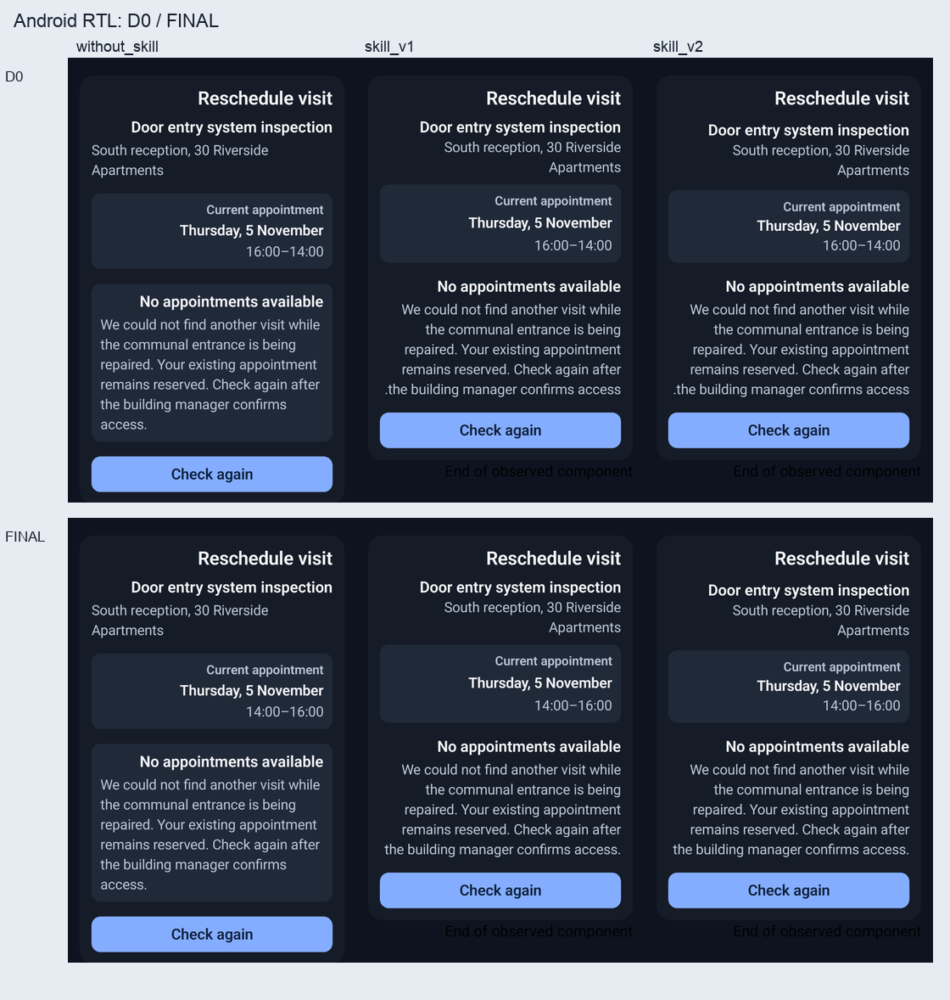
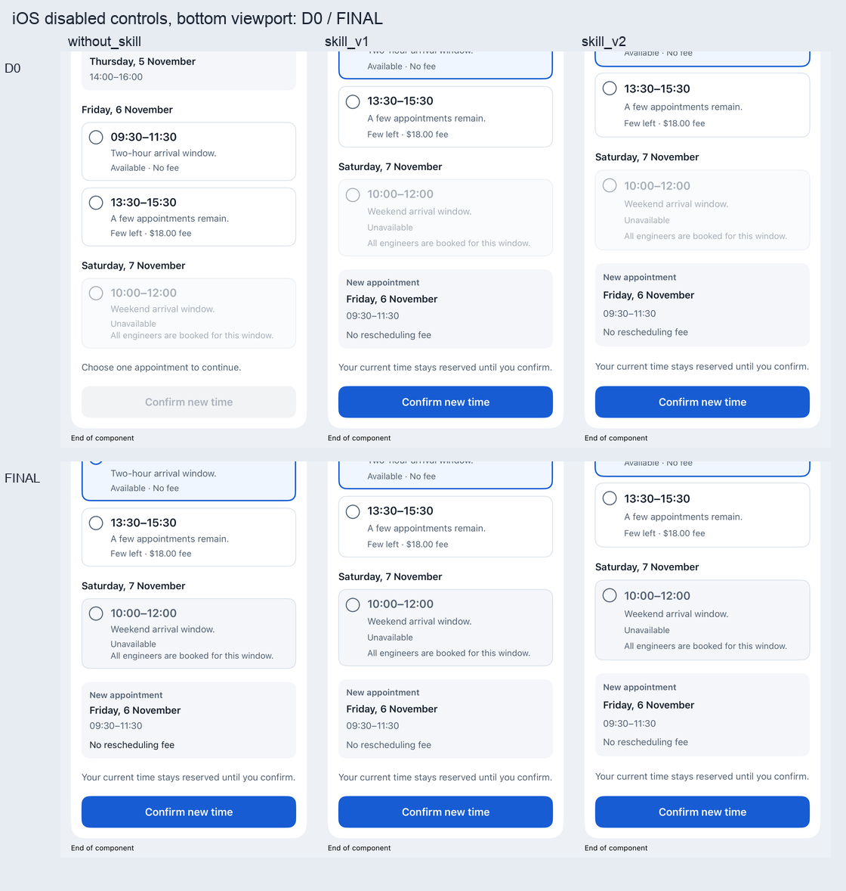

# 全新复杂 UI 的三臂盲测

已完成：先分析首轮、冻结通用改进，再独立设计一个全新的**服务预约改期组件**，比较无 Skill、原始 v1 和改进 v2。完成84组正式原生采集、1,086张快照，另有双端各1次干净检出复跑。设计、源码、自查、评分和检出匹配按顺序封存后揭盲。

**本轮仍未证实 v2 具有额外检出或修复收益。** 三组都找全并修复了各自已确认的首版缺陷；v2/v1 有同类 AX 解释误报，最终极端长内容采集也留下更多未评估项。有 Skill 两组的首版少一个 AX 标识缺陷，但单次结果不能证明这是 Skill 的因果效果。

## 结果与计算口径

| 指标，双端合计 | 无 Skill | 冻结 v1 | 改进 v2 |
| --- | ---: | ---: | ---: |
| 首版确认缺陷簇 | 3 | 2 | 2 |
| 首版失败场景×规则项 | 13 | 7 | 7 |
| 根因簇检出 TP / FN | 3 / 0 | 2 / 0 | 2 / 0 |
| 精确规则检出 TP / FN | 13 / 0 | 7 / 0 | 7 / 0 |
| 确认缺陷中的漏检率 | 0% | 0% | 0% |
| 确认误报规则项 / 独立发现 | 0 / 0 | 3 / 1 | 4 / 1 |
| 未裁定发现 | 2 | 1 | 1 |
| 首版确认失败修复 | 13 / 13 | 7 / 7 | 7 / 7 |
| 已评估初始项新增失败 | 0 | 0 | 0 |

本试验的无 Skill 对照仍是强 coding agent：共同提示已要求独立设计、真实渲染、自查规则/证据和一次修复，并共享新观测器。测到的是额外 Skill 文档与账本工具的增量，不能外推成“测试流程不比不测试好”。

首轮33.3%的规则归因漏检与本轮0%来自不同需求和矩阵；v1和无 Skill 本轮也都是0%，不能把这个跨题变化记成v2的提升率。

检出和修复分母仅为独立确认的首版失败，不含尚未评估的真实风险。根因与场景×规则分别计数，不把关联规则自动算作检出。源代码检查另列，未加入运行时分母。误报项按明确的同方面反证计数；表中未裁定发现不硬算作误报。

无 Skill 组也提出了类似的行包装节点质疑，但其同规则的首版记录已经因另一个 AX 标识缺陷失败、或缺操作证据；缺少同方面已封存通过的反证，评审将该质疑保持未裁定。**0项确认误报不能解读为它没有产生任何可疑误判**。另外每组各1项声明超出预定矩阵，不补入效果分母。完整裁决、证据和限制见[独立匹配](design/grader/review-match.json)。

## 原始封存评分与覆盖空白

下表为原始独立评分的 **通过 / 失败 / 未评估** 数量，必须结合每项 `unassessedMethods` 和覆盖附录阅读；“通过”只反映封存记录所评价的方面，不能自动解释为该复合规则所有子方面均得到实测。

| 平台 / 阶段 | 无 Skill | 冻结 v1 | 改进 v2 |
| --- | ---: | ---: | ---: |
| android / D0 | 58 / 1 / 0 | 58 / 1 / 0 | 58 / 1 / 0 |
| android / FINAL | 84 / 0 / 0 | 84 / 0 / 0 | 84 / 0 / 0 |
| ios / D0 | 32 / 12 / 15 | 53 / 6 / 0 | 53 / 6 / 0 |
| ios / FINAL | 82 / 0 / 2 | 76 / 0 / 8 | 76 / 0 / 8 |

每平台首版59项，最终84项（初始59＋隐藏25）。Android隐藏25项三组全部通过。iOS隐藏结果分别为无 Skill 23通过/2未评估，v1与v2各17通过/8未评估；没有证实的隐藏产品失败，**不能说隐藏场景全部通过**。

- 三组共同缺口：隐藏场景01在初始付费且已同意状态，只采到上部像素；协议切换调用方数据后才拍后续底部。因此R14/R15保留未评估。后续模型更新和真实回调已在同PID/实例中验证，不能用它们填补初始状态的视觉。
- v1/v2额外缺口：隐藏场景02的极端长内容中，目标x15在较早滚动图中完整可见且可点击，但后续目标搜索在局部可见位置之间反复切换并达到限额，实际点击未执行，相关R04–R09共6项未评估。不是“没有回调所以业务失败”，也不是“之前出现过所以操作通过”。
- 复合规则的进一步限制：例如R13还要求最小触摸区域，AX边界、源码声明和中心点击不能直接证明完整物理命中区域。独立评分里部分R13标为通过同时保留此方法未评估；这不是完整无障碍/触摸通过证明。覆盖附录单列这一统计口径，原始评分和检出匹配不回写。

[独立覆盖附录](design/grader/coverage-scope-addendum.json)在检出封存/揭盲后单独进行，审计者仍未读取组别；[指纹与时序](reporting-audit-seal.json)保留。它确认：没有完整冻结的原子检查账本，因此**无法得出“全部要求完整验证”的通过率**。双端共有36个必须但未测的Apple触摸区域方面，涉及31个原评分通过项及5个原评分失败项；加载分支无交互目标，不硬加这个缺口。

只排除这些已知缺证据的通过项，最终iOS可能完整支持的项数**上限**为无 Skill 75、v1 69、v2 69；这不是新的已验证通过数。附录另保留v1/v2隐藏场景02的R15实际操作范围限制。未列出缺口的项目也不会自动获得完整验证认证。原始得分、漏检分母和修复信用不回写。

正式84组各实际执行1项原生测试：77项原生采集测试通过、7项失败，原始失败全部保留。失败包括无 Skill 首版的5次AX目标问题，以及v1/v2最终各1次极端目标搜索未完成。它们与独立产品规则评分分开；不能把原生失败数直接当成产品缺陷数，也不能把采集成功当成业务通过。双端干净复跑另有2项原生测试通过。

数值视觉分数只评价已看到的区域。v2两个平台的极端长内容场景各4分（费用文字重排略紧），其余最终观察区域多为5分；隐藏场景01的分数明确为局部范围。没有用分数掩盖未评估要求。[原始统计及所有图示理由](result-summary.json)、[全部原生采集索引](native-capture-summary.json)。

## 发现、修复与新问题

三组均看见并修复 Android RTL 时间端点反序，以及 iOS 原生禁用样式再次降低显式颜色不透明度。无 Skill 组另外出现父标识覆盖子标识，导致真实AX目标缺失和部分后续动作无法执行；它自己的自查发现并修复了这个问题。没有注入已知错误，没有把独立评审反馈提供给实现者。

v1/v2的确认误报来自把复合行的 `Other` 包装节点、实际 Button 叶节点的不同字段直接当作产品状态错误；独立评审结合真实禁用叶节点、完整标签/selected语义和操作轨迹，已在相同方面封存通过。原始观察是真的，错误在业务解释。无 Skill 的同类质疑因证据条件不同保持未裁定。此处也只有 AI 评审，不能声称等价于人工 VoiceOver 审计。

新版账本可拦截缺项、非法证据方法和文件篡改，**不能保证计划拆全了所有要求，也不能保证代理填写的观察具有正确语义**。本轮表明继续堆叠提示词不足以证明收益。下一版应另立研究：独立检查需求拆分完整性、按每次输入状态采齐像素、用无业务含义的长列表探针验证目标搜索、以容器/叶节点联合状态降低误报。没有把这些新隐藏值或修正塞回本轮 Skill 重算成绩。

## 前后图



Android `initial_05` 的同一初始状态，三组均把 `16:00–14:00` 修正为 `14:00–16:00`。组合图仅作展示，原生原图及独立评分是证据。



iOS `initial_01` 的实际底部视口。无 Skill 首版的选时动作因AX标识缺陷未执行，另外两组已选中；**这些图片的终态不同，不是同状态像素 golden 对比**。可看到三组不可用行的禁用色修正；不能由图直接证明字号、内部padding或物理触摸区域。

## 时间与工程成本

| 实际墙钟 | 无 Skill | 冻结 v1 | 改进 v2 |
| --- | ---: | ---: | ---: |
| 首版实现 | 4:56.4 | 5:34.8 | 5:55.0 |
| 只读自查 | 4:12.2 | 3:10.3 | 5:59.7 |
| 一轮修复 | 15:00.9 | 13:13.1 | 8:55.3 |
| 三个阶段合计 | 24:09.5 | 21:58.1 | 20:50.0 |

三阶段时间包含各组自己的工具等待，不含操作员正式采集、独立评分与阶段间等待。正式有效采集命令每组另累计约39–44分钟，跨组并行，不能相加成总墙钟。还有公共接入修正、旧采集保留及评分成本。原始时间、等待区间和分平台采集耗时均见[timing.json](timing.json)。共享硬件、缓存和各组不同的首版缺陷使这些数字不支持提速因果结论。

## 为什么先改流程

[首轮分析](../improvement-analysis.md)指出两类不同问题：一个窄屏根因被看见，但关联规则归因不完整；iOS 单测截图宿主缺少实际 AX、操作和调用方更新证据。强对照已经共享详细设计与原生宿主，剩余增量有限，单题不能证明普遍无效或有效。

改进 v2 在新题实现前冻结：需求×场景×方面证据账本；运行时操作不能由源码/截图替代；完整滚动内容与实际底部证据；相关规则只进入复核队列，不自动获得检出信用；可选实际 App + XCUITest 观测器。账本验证完整性和证据类型，不判断语义真实性。没有把旧组件名、宽度故障或旧预期写成新题答案。

## 设计与试验控制

- [独立公开设计](design/public/brief.md)、[完整参考 SVG](design/public/reference.svg)、[冻结验收与隐藏输入](design/private/oracle.json)、[设计指纹](design-freeze.json)。17项公开规则，6个初始场景及2个修复前不可见场景；每平台初始59个、最终84个场景×规则项。源代码检查单列。
- 组件为调用方受控 `VisitReschedulePanel`：分组时段、可用/限量/不可用选择、费用同意、失效选择、确认/重试/完成、加载与结果态。覆盖长内容、窄屏、大字体、深色、RTL、普通父滚动和运行时替换。
- 相同固定上游：Reply `53dccc7836952e3a04ed4bc1ec7afa7c8e27ff79`；AlertToast `76a1c1793cd3443001c20c6033beb84453b25d9f`。只添加公共宿主依赖后开始实现；没有复制上一题组件或注入错误。
- 相同模型/推理配置、工具、公开资料和硬件。服务构建、随机种子、token核算不可得。公共宿主的能力对三组一致，不把新观测器的公共收益归因于 v2。
- 双端首版实现上限25分钟，不看产品渲染图；编译和单个公开例子集成可用。独立首版评分封存后，各组进行12分钟只读自查；随后只凭自己的发现做一轮15分钟修复。独立评分和隐藏场景始终不提供给实现者。允许提前完成，工具等待计入各自阶段实际墙钟时间。
- 最终独立重跑全部8场景；评审在首版、最终评分均封存后，才读取各组自查做检出匹配，最后揭盲。

完整[预注册](PREREGISTRATION.md)、[材料冻结](freeze.json)、[公共提示及边界](prompts/README.md)、[事件记录](run-log.json)、[首版评分封存](d0-grade-seals.json)提供时序。隔离靠共享文件系统上的访问约定，**不是对抗式或操作系统级盲法**；根操作员知道分配但不评分。

预算偏差原样记录在[protocol-deviations.json](protocol-deviations.json)：一组报告序列化于900.856秒结束，比900秒上限晚0.856秒，源码修改已提前停止；未把时间夹成900秒。该组仍在运行的长文本采集于报告封存后才导出，未算作它在修复阶段已审阅的证据，最终仍独立重跑。

## 原生证据能证明什么

Android 在同一个挂载 ComposeView 中使用连续 Paparazzi 帧，执行真实语义 OnClick、宿主受控回显和 ScrollState 位移。不是物理触摸、Activity、TalkBack 服务或整页导航验证。截图实际被渲染器缩放，证据记录逻辑视口到实际 PNG 的映射，不能直接把 density 当作截图比例。

iOS 使用真实 App + XCUITest：运行时 AX/屏幕点坐标、真实点击/回调、同进程身份和调用方模型替换、实际字体类别/主题/方向、重叠滚动和底部采样。实际运行时为 iOS26.5；iOS14/macOS11最低版本只作源代码类型检查。字体类别映射不是与 Android fontScale 的数值等价。

AX frame 不是内部 padding、实际字号或完整触摸区域；没有通用 SwiftUI 样式树。原生像素和截图判断可支持指定区域的颜色/可读性，不能据此声称读到了所有计算属性。节点不可达的后续动作保持未评估，不因为原生测试运行了就全部通过。

本轮直接测试新增的可调用组件，并按公开契约提供稳定 AX 标识。它没有验证任意旧项目在零修改条件下、仅靠模糊业务描述定位所有目标的能力，也没有验证实际业务页面的导航、键盘和生命周期。

## 公共宿主修正及成本

[通用探针](../observer-probes/README.md)独立于业务验收。开始前探针覆盖 AX、回调、同进程更新、双向滚动和实际环境；接入后又发现探针范围的不足。共四项公共修正，均保留[原始版本与哈希](host-amendments.json)及原始尝试，对受影响三组统一重跑，未替任何组修业务源码：

1. 构建检查的 x86_64/arm64 架构不一致；命令增加明确 arm64。
2. 真实包导入的采集路径同样需要架构设置；初始简单桥接虽链接包却未真正导入/渲染，遗漏了这一条件。18个未执行测试的原始构建失败保留，不能当作产品失败。
3. 标准 Material 控件回调后的早期截图采到动画中间态；无关控件探针中八帧采样与新建最终状态的控件区域逐字节相同。三组18次 Android 采集统一重跑，原始图保留。这不保证任意动画都能用相同帧数稳定。
4. 原生 Switch 的语义容器与实际开关叶节点分开记录并激活；缺失目标搜索到实际底部后按未观测停止。最小探针中旧直接 `.tap()` 也成功，显式容器中心坐标失败，不能夸称旧方法普遍失效。原始12次已完成 iOS 采集保留并统一重跑；另一中断尝试不虚构完成数。

这些接入修正与重复采集属于工程成本，不计为新增组件缺陷或 v2 独享效果。实验中[冻结 v2](skill-v2/)的工作流不变；当前可复制 Skill 随后只回移相同通用适配器修正，版本差异见[已发布适配器补丁](shipped-adapter-patch.json)。

## 干净检出复跑

[复跑记录](replay/replay.json)使用封存最终源码，在全新目录重新克隆两个固定提交、安装公共宿主，执行公开例子。Android与iOS各1个真实原生测试和采集成功，生产源码指纹与封存一致。这2次不计入预注册的84组盲测场景，也不额外赋予视觉通过分。

## 复跑与审计

需要 macOS、完成设置的 Xcode及已安装 iOS模拟器、Android SDK36、JDK21。上游版本固定，但不同渲染器/运行时仍可能改变图像。以下命令只接受新的工作目录：

```sh
python3 validation/fresh-blind/prepare.py \
  --workspace /absolute/new-workspace \
  --submission /absolute/native-ui-agent/validation/fresh-blind/implementations/final/SUBMISSION \
  --java-home /absolute/jdk-21/Contents/Home \
  --android-sdk /absolute/Android/sdk \
  --ios-device YOUR_SIMULATOR_UUID
```

`prepare.py`克隆固定提交、添加公共宿主和封存生产文件，提取 JDK java.desktop 依赖并写入本机配置。`check_compatibility.py --output /absolute/new-compatibility-results`可单独重跑已封存 Swift 源码的六项最低版本类型检查，仍不提供旧系统运行时证据。用新工作目录内的 `harness/capture.py --help`执行指定平台和 fixture；捕获不包含评分。完整固定场景可通过仓库 `run_trial.py capture --workspace ... --phase final --output ... --simulator ...`重跑，此入口会使用已准备目录自己的宿主。

```sh
python3 validation/observer-probes/verify_preflight.py
python3 validation/fresh-blind/verify_evidence.py
```

已从提交 `af88014` 的纯Git归档解压到新路径，在没有任何忽略目录的条件下通过38项单元测试与上述四套归档审计；[核验记录](verification.json)保留命令和源提交。

跨机器审计只重算哈希、原生测试数、输入/源码绑定、评分覆盖与统计，**不重新运行 Xcode/Gradle、AI 实现或视觉判断**。原始绝对路径保留供追溯，报告引用可按 `validation/`锚点映射到当前检出目录。完整 SDK/DerivedData/xcresult 缓存留在本地忽略目录，便携 PNG、JSON、日志和源码指纹保留。

设计和评分均由独立上下文的 AI agent 完成，并非人工金标准；规则、原始证据与裁决理由公开供复核。一个新任务、每组一次运行、双端相关、共享硬件缓存，结果是描述性证据。不能据此给出普适提升率、统计显著性或可靠提速结论；零缺陷分母记 N/A，未评估不算通过。

`design/grader/`中的 `.draft.json`、早期裁剪和中间测量用于追溯采集器修正；统计只读取无 draft 后缀且带封存时间的 D0/FINAL 评分与之后的检出匹配。它们不覆盖原始封存。
