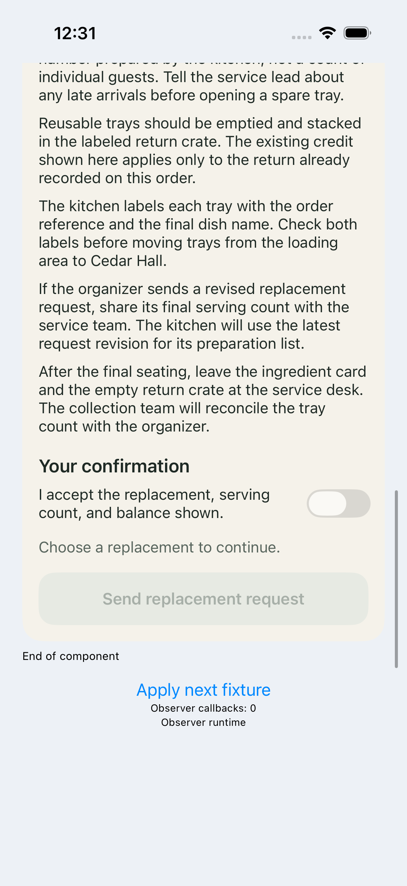
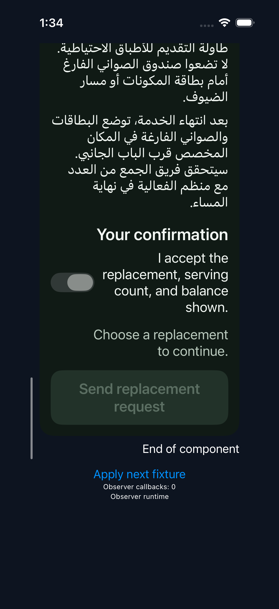
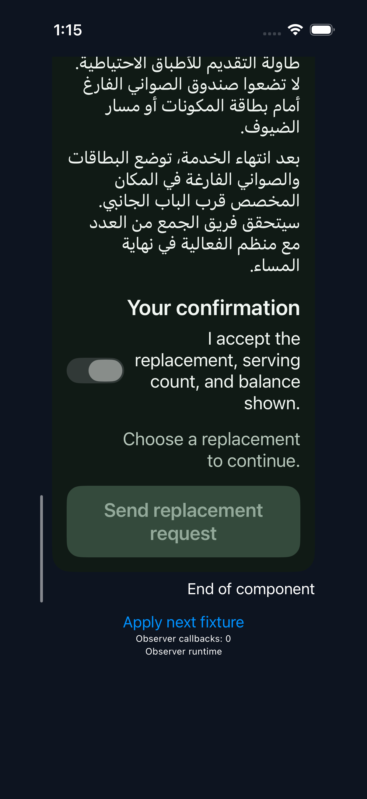
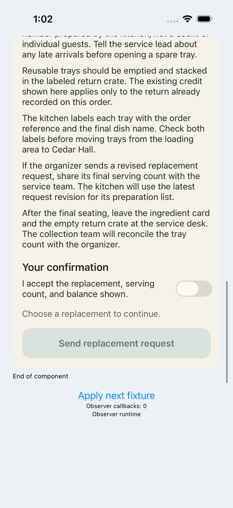

# 原始界面与实际配色

全部为原始 XCTest 帧，没有生成替代图。此处只列导致同一视觉原因的 draft/send-fill 示例；完整滚动帧、状态、输入和源码绑定保留在原包。

## A/D0/ios

独立预期 `#FFD9E2DC`；原始像素 `#FFE7EAE3`，判定 F。

## initial/private/ios

独立预期 `#FF344A3C`；原始像素 `#FF223229`，判定 F。

## A/Final/ios

独立预期 `#FFD9E2DC`；原始像素 `#FFD9E2DC`，判定 P。

## A/private/ios

独立预期 `#FF344A3C`；原始像素 `#FF344A3C`，判定 P。

## B/Final/ios

独立预期 `#FFD9E2DC`；原始像素 `#FFD9E2DC`，判定 P。

## B/private/ios

独立预期 `#FF344A3C`；原始像素 `#FF344A3C`，判定 P。

源码：[自然初版](business-quality/packet-public/source/initial/MenuChangeReviewPanel.swift)、[A 最终](business-quality/packet-public/source/A/MenuChangeReviewPanel.swift)、[B 最终](business-quality/packet-public/source/B/MenuChangeReviewPanel.swift)。两份修复均保留禁用语义，修改 ButtonStyle，不改设计预期或采样阈值。
