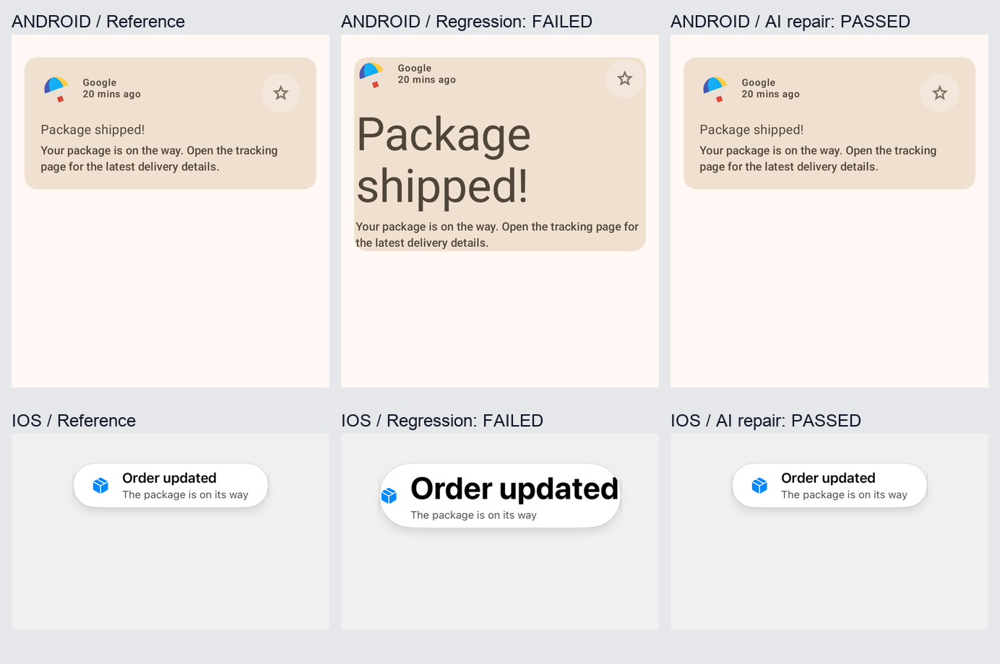

# Native UI Agent 双端实跑报告

2026-10-18，在本机实际克隆、构建、修改、渲染和修正两个开源工程。两端各注入一组布局/文字回归，均在 **1 轮源码修正**后通过普通、长文本、深色三种状态，共 **6/6**；参考图没有更新。Android 另通过实际模拟器的页面点击复验。

这是受控回归试验，验证了 Skill 的执行闭环和证据链。Agent 知道注入错误的计划，没有盲测或不使用 Skill 的对照组，因此不能据此量化真实 PR 质量提升。



拼图仅用于展示，做了等比缩放；所有断言使用完整原始 PNG，没有对齐、缩放或模糊处理。

## 使用的真实工程

| 平台 | 工程 / 固定提交 | 实际组件 | 接入方式 |
| --- | --- | --- | --- |
| Android | [android/compose-samples](https://github.com/android/compose-samples/tree/53dccc7836952e3a04ed4bc1ec7afa7c8e27ff79/Reply)，Apache-2.0 | Reply 的生产 `ReplyEmailListItem` | 新增薄的 JUnit/Paparazzi 宿主，调用原主题、组件、头像资源及本地数据提供器 |
| iOS | [elai950/AlertToast](https://github.com/elai950/AlertToast/tree/76a1c1793cd3443001c20c6033beb84453b25d9f)，MIT | 生产 `AlertToast.hud` | Swift Package 测试 target 增加 SnapshotTesting；XCTest 在实际 iOS 模拟器内，用 UIHostingController 承载生产组件 |

没有复制重画 UI，也没有为生产组件增加业务 ID。测试代码、依赖配置和状态 fixture 属于本次接入工作。这个试验验证的是 Compose 和 SwiftUI；UIKit、Android XML/View 尚未在这里实跑。

Android 采用真实历史提交，继承 AGP 8.13.0、Kotlin 2.2.21、Compose BOM 2025.10.01 和 SDK 36，未升级原应用构建版本。新增 Paparazzi 2.0.0-alpha02、JUnit 测试依赖。JDK 为 JBR 21.0.11。

iOS 保留原 Swift tools 5.3 和 iOS 14 部署要求，新增 SnapshotTesting 1.19.2。实跑环境是 Xcode 27.1 (27A9275)、iOS 26.5 (23F77)、iPhone 17 Pro 模拟器；截图画布 390×240pt、显示 scale 2，实际 PNG 780×480。传递依赖锁定在 [Package.resolved 副本](adapters/AlertToast.Package.resolved)。

## 实际结果

先查看未修改上游代码的渲染图，选定并冻结参考，再修改生产文件、读取失败图、形成诊断、修改生产代码，最后重新 capture/review。参考代表“保留上游外观”这条试验要求，不等于设计师审批过新设计。

| 平台 | 注入的生产代码回归 | 检测结果 | 源码修正 | 修正后 |
| --- | --- | --- | --- | --- |
| Android | 内 padding 20dp → 2dp；主题 `bodyLarge` → `displayLarge` | 标题异常放大、内容贴边；23.609% 像素改变；外层布局高度 171.27272dp → 247.63637dp | 恢复项目原有 spacing 和 typography | 3/3 状态通过；像素差异均为 0；实测宽高符合冻结期望 |
| iOS | HUD 水平 padding 24 → 2；默认标题 `body.bold()` → 38pt system bold | 标题过大、左右留白失衡；21.748% 像素改变 | 恢复 HUD 原有默认字体和水平 padding | 3/3 状态通过；像素差异均为 0 |

错误版本的原生渲染测试本身也成功执行：能生成图片不等于 UI 合格。失败来自之后的视觉/像素/布局断言，而不是编译报错。

每个最终场景的原生框架报告都确认执行了 **1 个测试，0 个失败**。修正后 capture 命令耗时：Android 2.96–4.15 秒，iOS 4.97–6.13 秒。它们包含缓存构建、原生测试及导出，不包含 AI 推理时间、初次依赖下载和模拟器启动，也不是跨机器性能基准。

| 场景 | Android | iOS |
| --- | --- | --- |
| 普通内容 | [通过报告](evidence/android-repaired-normal-review/report.json) / [实际图](evidence/android-repaired-normal-1/artifacts/000-actual.png) | [通过报告](evidence/ios-repaired-normal-review/report.json) / [实际图](evidence/ios-repaired-normal-1/artifacts/000-actual.png) |
| 长文本 | [通过报告](evidence/android-repaired-long-review/report.json) / [实际图](evidence/android-repaired-long-1/artifacts/000-actual.png) | [通过报告](evidence/ios-repaired-long-review/report.json) / [实际图](evidence/ios-repaired-long-1/artifacts/000-actual.png) |
| 深色 | [通过报告](evidence/android-repaired-dark-review/report.json) / [实际图](evidence/android-repaired-dark-1/artifacts/000-actual.png) | [通过报告](evidence/ios-repaired-dark-review/report.json) / [实际图](evidence/ios-repaired-dark-1/artifacts/000-actual.png) |
| 错误版本 | [失败报告及差异目录](evidence/android-regression-normal-review/report.json) / [错误图](evidence/android-regression-normal-1/artifacts/000-actual.png) | [失败报告及差异目录](evidence/ios-regression-normal-review/report.json) / [错误图](evidence/ios-regression-normal-1/artifacts/000-actual.png) |

每份 capture 保存命令、退出码、耗时、声明的源文件哈希、参考哈希、原生报告和本轮原图；review 绑定对应 capture 的 SHA-256。历史失败报告记录当时的代码状态，修正代码后不能拿旧 capture 声明当前代码通过。

## 页面复验与测量边界

Android 重新构建 APK、安装到 read-only API 36.1 模拟器，启动真实 Activity，从当前 UIAutomator 树查找 `Package shipped!`，取该节点本轮 bounds 中心点击，确认详情标题及 Reply All，再定位 Back 返回收件箱。没有新增 ID，也没有凭记忆写坐标。[执行记录](evidence/android-page-repaired/report.json)、[收件箱](evidence/android-page-repaired/inbox.png)、[详情](evidence/android-page-repaired/detail.png)、[脚本](adapters/verify_android_page.py)。这只证明该页面路径，没有覆盖整个应用的业务判断。

iOS 工程本身是组件库。本次运行真实模拟器 XCTest 宿主及 SnapshotTesting，未补造一个业务 App，所以没有声称已验证导航、键盘或完整业务页面。

Android 数值来自测试调用点现有 modifier 上的 `onGloballyPositioned` / `LayoutCoordinates.size`，是该层组件宽高，包含该 modifier 位置对应的外层布局。它不是内部 padding 或字形边界。iOS 本次使用原生渲染图与像素断言，没有通用 SwiftUI 样式树。表格中的 padding/字体变更值来自明确的源码变更，不是 AI 从图片估算出的“实际生效属性”。两端都没有证明能无侵入读出所有控件的实际字号、颜色及每层间距。

## 接入时实际遇到的问题

- Android Kotlin 测试编译环境不能直接引用 `java.awt.BufferedImage` 编写截图 handler。改用 Paparazzi 自带 HtmlReportWriter，解析本轮 run 的目标测试和实际图片，再导出一张 actual。
- Reply 主题在非 edit mode 下将 `LocalView.context` 转为 Activity；渲染宿主是 BridgeContext。仅 `LocalInspectionMode=true` 仍会崩溃。测试宿主提供 `isInEditMode=true` 的 LocalView，调用原主题，跳过窗口副作用。真实窗口另在 Activity 模拟器验证，生产主题没有为测试改写。
- Paparazzi 配置 1080×1200，但该版本默认导出为 900×1000。断言使用实际解码尺寸，未把设备配置当作图片尺寸。
- Gradle 测试进程与 Xcode 测试进程都需要显式接收场景和输出目录。Gradle 在 capture 时强制 test task 执行、保留编译缓存；iOS 先 build-for-testing，将环境写入 xctestrun，再 test-without-building，同时保留 `__TESTROOT__` 原义。Xcode 的 xcresult 也必须确认测试数，不能只检查命令退出码。
- 原 Swift tools 5.3 的 PackageDescription 不支持新的 `exact:` 标签，使用其支持的 `.exact(...)` 依赖声明，保留旧 tools 版本。
- iOS 首次被 Xcode 许可设置阻止，用户完成设置后才开始实跑；没有把环境阻塞记为通过。

前面的宿主接入失败保留在 evidence 的 baseline 尝试目录内；最终有效证据以本报告及 [result-summary.json](result-summary.json) 索引为准。这些经验已写回 Skill 的平台适配说明。

## 本机复跑

从本工作区根目录执行。当前 profiles 保存了本次实际绝对路径、JDK/SDK 和设备 UUID；迁移到其他机器时先按真实环境重写命令参数与环境记录。不要修改 checks 来迁就错误结果，也不要直接覆盖 references。不同 OS/渲染器的像素基准需要重新审阅。

```sh
export DEVELOPER_DIR=/Applications/Xcode.app/Contents/Developer
xcrun simctl boot AB66271B-29BD-4D14-9C9B-71579E147DCA
xcrun simctl bootstatus AB66271B-29BD-4D14-9C9B-71579E147DCA -b

python3 -B native-ui-agent/scripts/ui_loop.py capture \
  --project validation/native-ui-pilot/checkouts/alerttoast \
  --profile validation/native-ui-pilot/profiles/ios-normal.json \
  --output validation/native-ui-pilot/evidence/ios-new-normal-1

python3 -B native-ui-agent/scripts/ui_loop.py capture \
  --project validation/native-ui-pilot/checkouts/compose-samples/Reply \
  --profile validation/native-ui-pilot/profiles/android-normal.json \
  --output validation/native-ui-pilot/evidence/android-new-normal-1
```

每次使用新的输出目录；重复其他场景时选择对应 long/dark profile。让 agent 读取实际图，按 Skill 协议写带本轮 capture 哈希的 visual-findings.json，然后调用 `ui_loop.py review`。runner 不内置模型；coding agent 承担读图、诊断和源码修正。不能把旧 findings 的哈希复制到新证据上冒充本轮看图。

当前代码均已修正；要重现受控回归，用 `git apply` 对指定克隆应用 [Android 回归补丁](patches/android-regression.patch) / [iOS 回归补丁](patches/ios-regression.patch)，capture、看图及 review 后再修复。对应 [Android 修复补丁](patches/android-repair.patch) / [iOS 修复补丁](patches/ios-repair.patch)用于核查本次 AI 实际修改，不能把直接应用已知修复当作新的盲测。

```sh
python3 validation/native-ui-pilot/collect_results.py
```

此审计脚本已实际运行，核对本次 6 份通过报告、2 份失败报告、capture 绑定、原生产物哈希、原生测试数、参考文件未变和页面报告；它不调用模型、不重新判图，也不重新执行原生测试。

收尾还执行了 runner 的 25 项测试（全部通过）和 Skill 格式校验（通过），核对两份生产组件恢复为固定上游提交内容、测试宿主与交付副本一致、host/回归/修复补丁可对应应用、本文本地链接有效。本次创建/启动的模拟器在结束后关闭，iOS 试验设备保留供复跑。

## 接入文件与后续工程化

[Android 宿主](adapters/ReplyNativeUiTest.kt)、[Android 导出适配器](adapters/capture_android.py)、[iOS 宿主](adapters/AlertToastNativeUiTests.swift)、[iOS 导出适配器](adapters/capture_ios.py)、[Android 构建接入补丁](patches/android-host.patch)、[iOS Package 接入补丁](patches/ios-host.patch)。重新克隆固定提交后，应用 host 补丁，把对应测试文件放进 Reply 的 `app/src/test/java/com/example/reply/` 和 AlertToast 的 `Tests/AlertToastTests/`，并复制各自 references 中三张 PNG 至工程 `native-ui-baselines/`。Android 配置实际 SDK/JDK；iOS 使用已安装的模拟器和依赖锁。不是任意旧项目零配置适配器。

对既有项目，合理的产品形态是“按本次 PR 定位组件并生成薄宿主 → 固定 fixture 与期望 → 真实渲染 → AI 看图和确定性断言 → 局部修正 → 页面复验”。本次不要求全项目埋点，但仍付出了组件宿主和构建适配成本。下一步评估应使用未预告的真实历史 PR、独立预期和失败集，对比不使用 Skill 的结果，统计漏检、误报、修复成功率及耗时。
