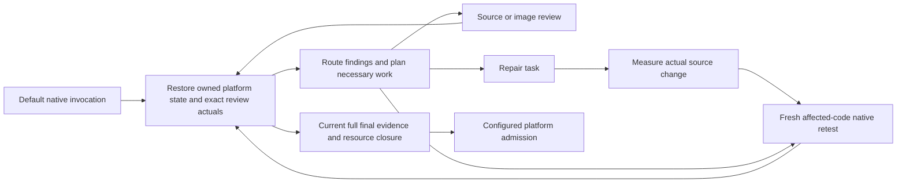

# Default execution and attribution

The production implementation is frozen as `candidate-v13.9` in
`CANDIDATE-FREEZE-10.json`. This document explains that frozen implementation;
publication/review helpers do not change its source, criteria or behavior.

| Capability | Default code path | Evidence and boundary |
| --- | --- | --- |
| Owned iOS pool | `resource_manager.py`, `pool_watch.py` | Default maximum one owned simulator per resource root; active, idle and retiring entries consume slots. Compatibility, exclusive lease, finite idle/age/use limits and positive ownership govern checkout and retirement. Independent PR roots need an external shared concurrency bound. |
| Platform invalidation | `source_identity.py`, `capture_validity.py` | Stable original source-root indices, explicit iOS/Android/shared groups, declared/conventional build files, hashed environment selectors, native tool/input identities. Unclassified or overlapping roots conservatively affect both platforms. This is a declared dependency boundary, not arbitrary compiler dependency discovery. |
| Original packet adoption | `capture_validity.py`, `execution_plan.py` | Independently approved finite fixture-validity policy, fresh fixture proof, shared kernel clock and host boot identity, current exact context/source, complete FULL original package and member hashes. F/U and original timestamps remain. New final resource closure is mandatory. |
| Durable repair handoff | `workflow_state.py`, `feedback_loop.py` | Per-platform locked owned state; exact task/capture/context refs; measured source-map changes; append-only completion; new affected-code native retest and full final gates. A task or measured patch alone is not repair success. |
| Evidence and work routing | `requirement_routes.py`, `locator_diagnostics.py`, `retest_plan.py`, `evidence_responsibility.py` | Current bound source/image actuals enter the default plan. Unsupported measurements, work items, product hypotheses and infrastructure errors remain distinguishable. |

The default `ui_loop.py native` entry invokes the state machine, including when
the caller omits an explicit `workflow.root`: a separate sibling of the resource
root is inferred. Use stable resource/workflow roots throughout one PR. State is
bound to the owned directory inode and complete production-root ownership hash;
each platform has its own lock/checkpoints and finite cycle budget. Explicit
previous handles are checked, and registered context-matching captures/history
are discovered automatically. Unknown or altered state cannot silently authorize
an old screenshot or erase an open repair.

Device reuse resets the generated observer's native fixture/process/input/event
state. It reuses the device and eligible compiled host, while acquiring new UI
facts. Screenshot adoption is a separate permission and validity decision.
`resources.pool: false` requests one-shot retirement. Default idle/use/age limits
are 300 seconds, 12 checkouts and 3600 seconds; policy maxima are bounded. The
guardian uses the resource journal/lock to retire expiry and recover interrupted
owners. Borrowed devices and shared SDK/JDK/Gradle caches are outside the owned
deletion set. Final, error and explicit cleanup paths record their closure.

An open repair binds the approved oracle/bridge/environment context. Changing
that context requires independent new-scope admission; it cannot clear the old
repair. A pending measured patch prevents adoption of pre-patch evidence.
`patched_needs_native_retest` is a handoff proof. Closing a handoff still does not
certify every obligation of the other platform, integration or whole PR.

The comparison control is `baseline-v12.6-common-6`, with the explicitly retained
common correctness floor: 18 paths, including 15 exact common files and three
version-adapted execution paths. These common fixes include valid action/source,
native geometry/coverage and execution checks needed for a fair experiment.
Pooling, platform-selective identity, final packet adoption and the new default
repair state machine are not backported as treatment benefits. Every rejected
common-floor revision remains retained.

The qualified AB/BA workload separately approved finite deterministic-component
packet validity and measured 25.2936% collection-wall reduction with identical
required judgments. The five-task business cohort has no such validity approval;
its ordinary final acquisitions remain fresh. Actual feature occurrences must be
counted from receipts; configuration or qualification alone earns no business
reuse, repair or quality credit.

iOS uses Simulator/XCUITest with bounded native geometry calibration; external AX
does not provide a generic computed-style tree. Android uses Paparazzi/Layoutlib
and Compose semantic actions in a fresh JVM, not OS physical touch. Minimal
markers are added to the new controlled components. This study does not establish
arbitrary marker-free whole-app/BE navigation or release readiness. See
[the integration guide](../../native-ui-agent/references/pooled-workflow.md) for
configuration and explicit adoption prerequisites.
