# 原始 native 截图：固定第0帧

每个匿名版本、每个平台固定展示原始私有采集的第0帧。I为公共初版，X/Y为两份匿名最终版本。图片保留原始字节；点击可查看原图。

这组预览不构成设计参考、完整状态覆盖或质量判定。原始包、状态和输入/事件绑定、SHA256记录在 [MANIFEST.json](MANIFEST.json)。

## Case01 / ios

| I | X | Y |
| --- | --- | --- |
| <a href="images/Case01-I-ios.png">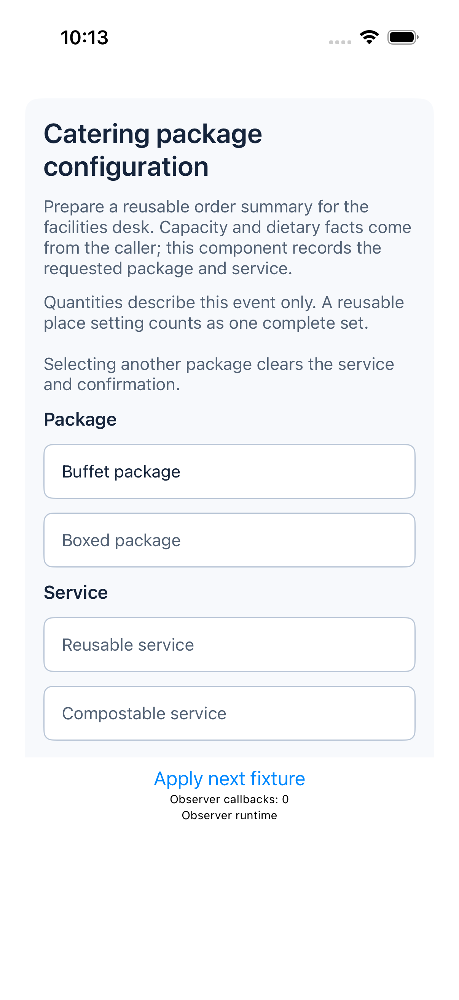</a> |  |  |

## Case01 / android

| I | X | Y |
| --- | --- | --- |
|  |  | <a href="images/Case01-Y-android.png">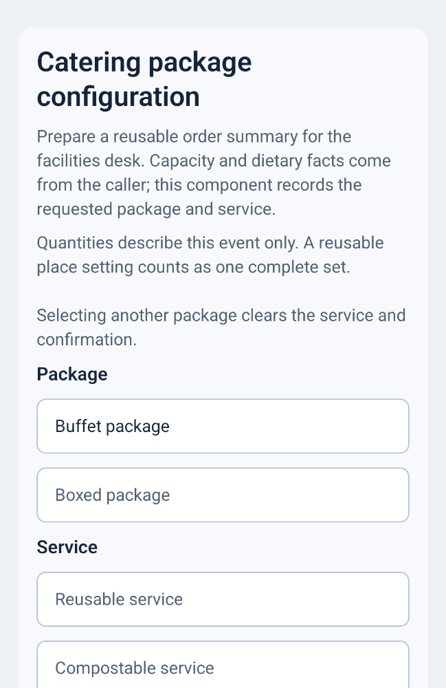</a> |

## Case02 / ios

| I | X | Y |
| --- | --- | --- |
| <a href="images/Case02-I-ios.png">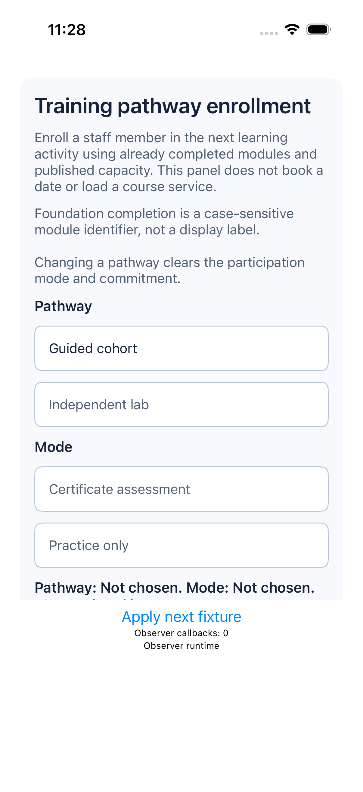</a> |  | <a href="images/Case02-Y-ios.png">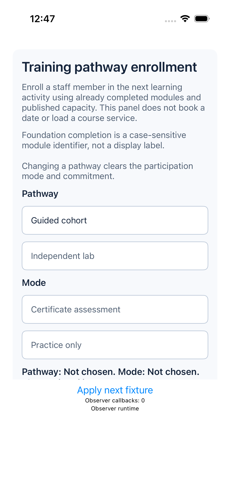</a> |

## Case02 / android

| I | X | Y |
| --- | --- | --- |
|  |  | <a href="images/Case02-Y-android.png">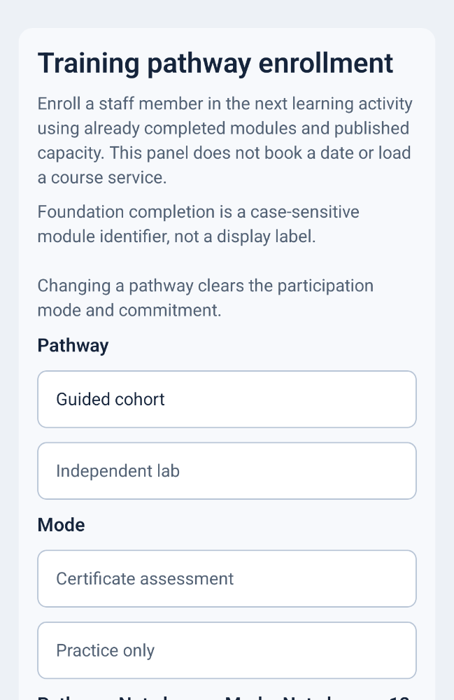</a> |

## Case03 / ios

| I | X | Y |
| --- | --- | --- |
| <a href="images/Case03-I-ios.png">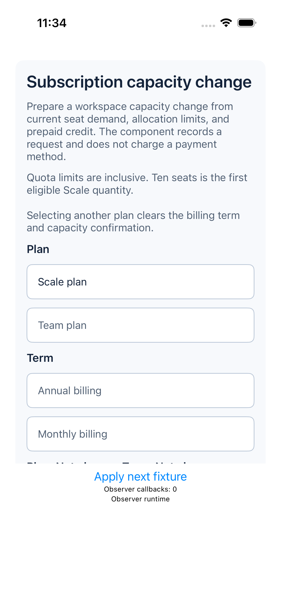</a> |  | <a href="images/Case03-Y-ios.png">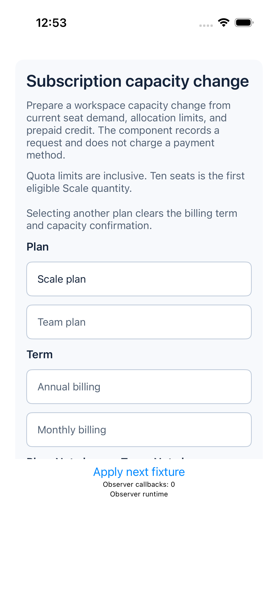</a> |

## Case03 / android

| I | X | Y |
| --- | --- | --- |
|  | <a href="images/Case03-X-android.png">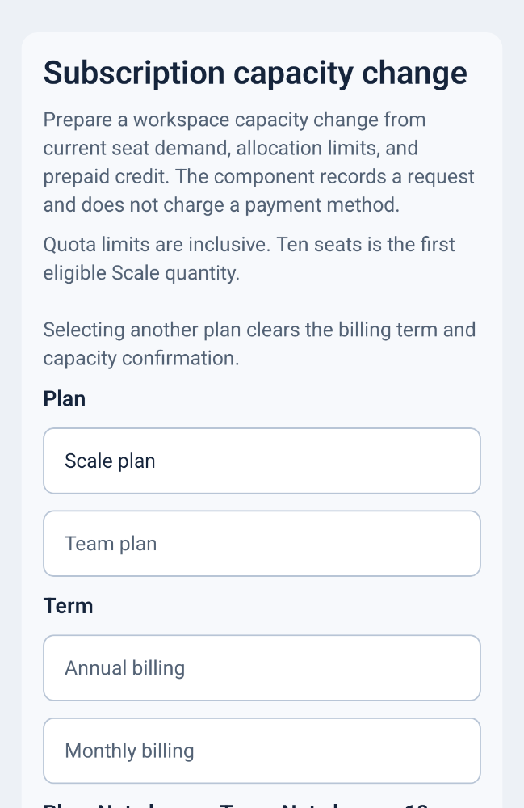</a> |  |

## Case04 / ios

| I | X | Y |
| --- | --- | --- |
| <a href="images/Case04-I-ios.png">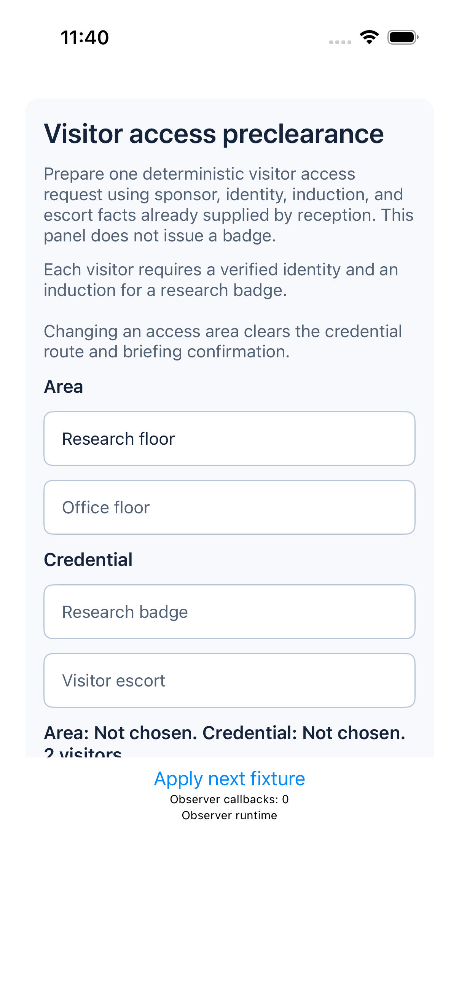</a> |  | <a href="images/Case04-Y-ios.png">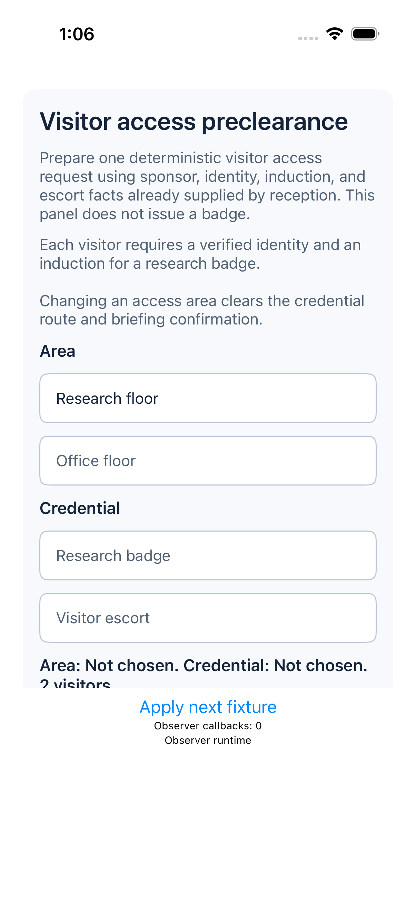</a> |

## Case04 / android

| I | X | Y |
| --- | --- | --- |
|  | <a href="images/Case04-X-android.png">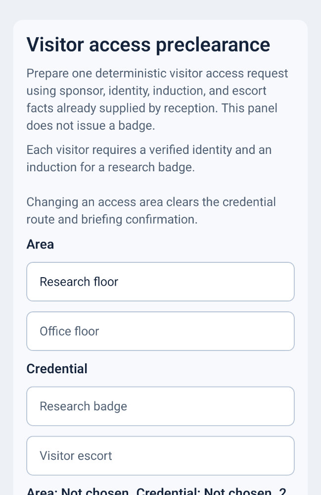</a> |  |

## Case05 / ios

| I | X | Y |
| --- | --- | --- |
| <a href="images/Case05-I-ios.png">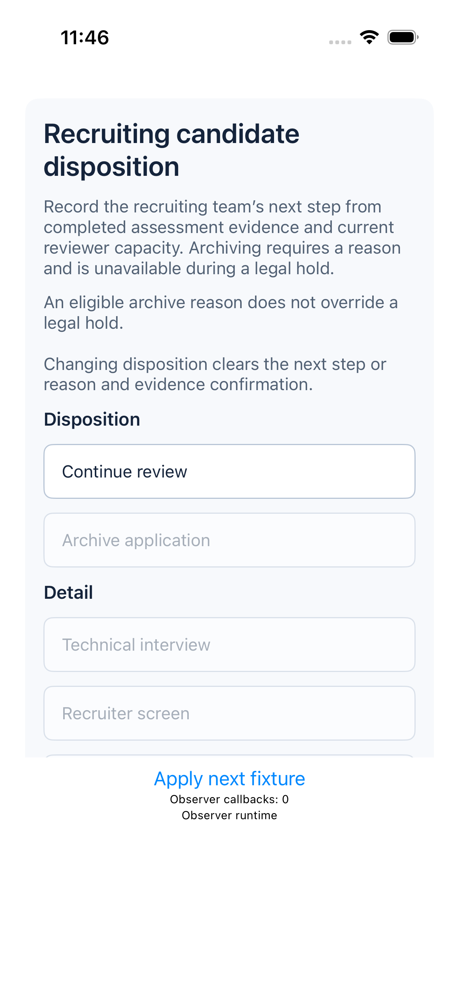</a> |  | <a href="images/Case05-Y-ios.png">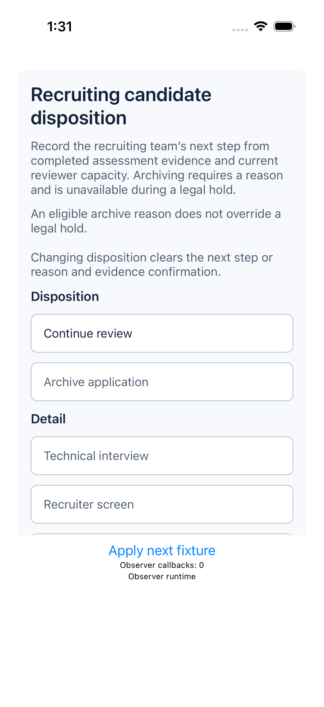</a> |

## Case05 / android

| I | X | Y |
| --- | --- | --- |
| <a href="images/Case05-I-android.png">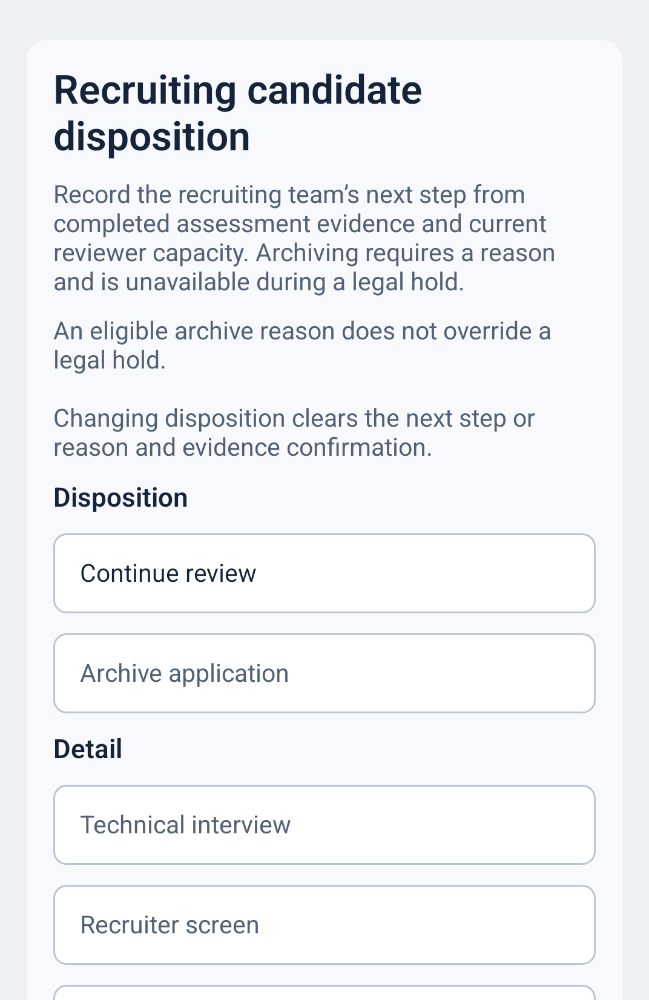</a> |  |  |
