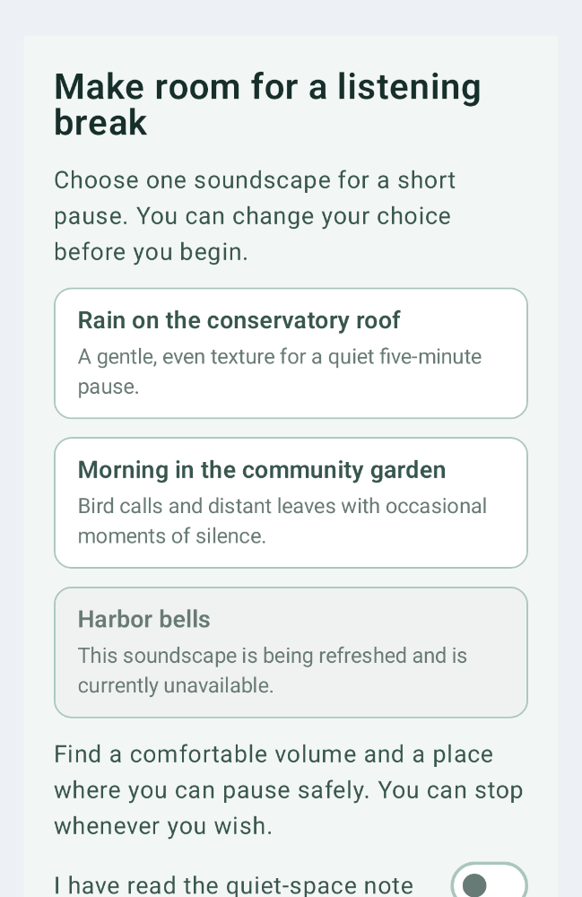
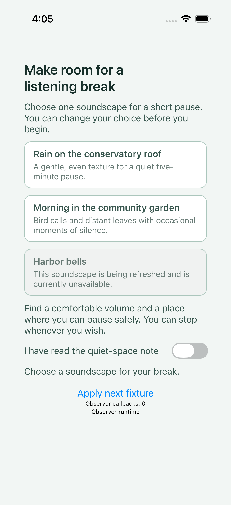
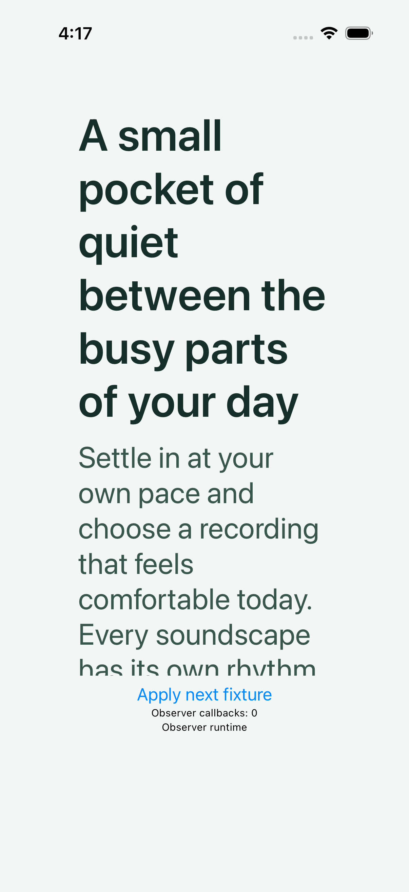
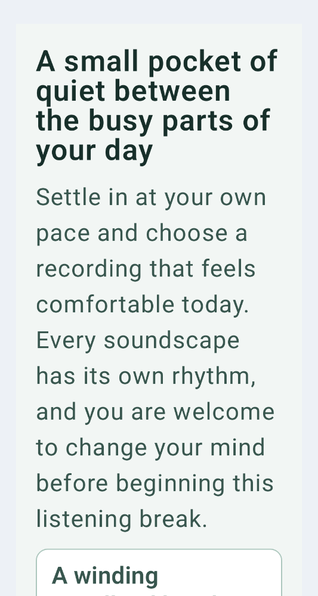

# Original component captures

Images are original screenshots; no reconstructed replacement or rebaselining. Accessibility fixes may leave the visible component unchanged. See raw native trees and source causes alongside images.

## v10 / public / ios

## v10 / public / android

## v10 / private / ios

## v10 / private / android

## v11 / public / ios

## v11 / public / android

## v11 / private / ios

## v11 / private / android

