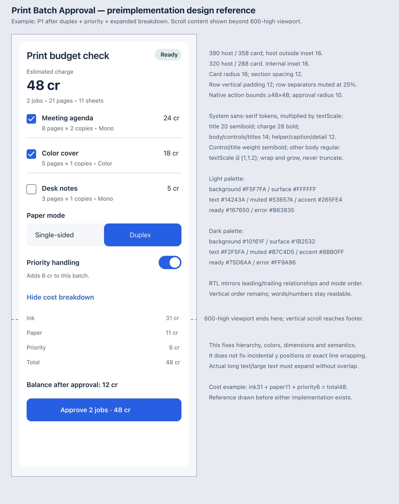
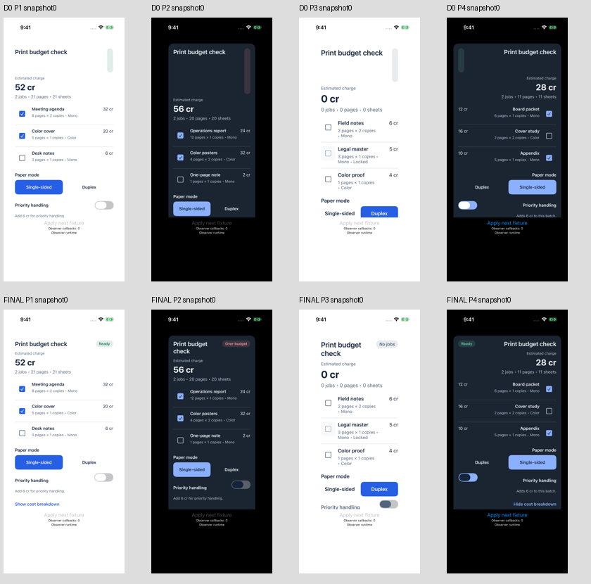
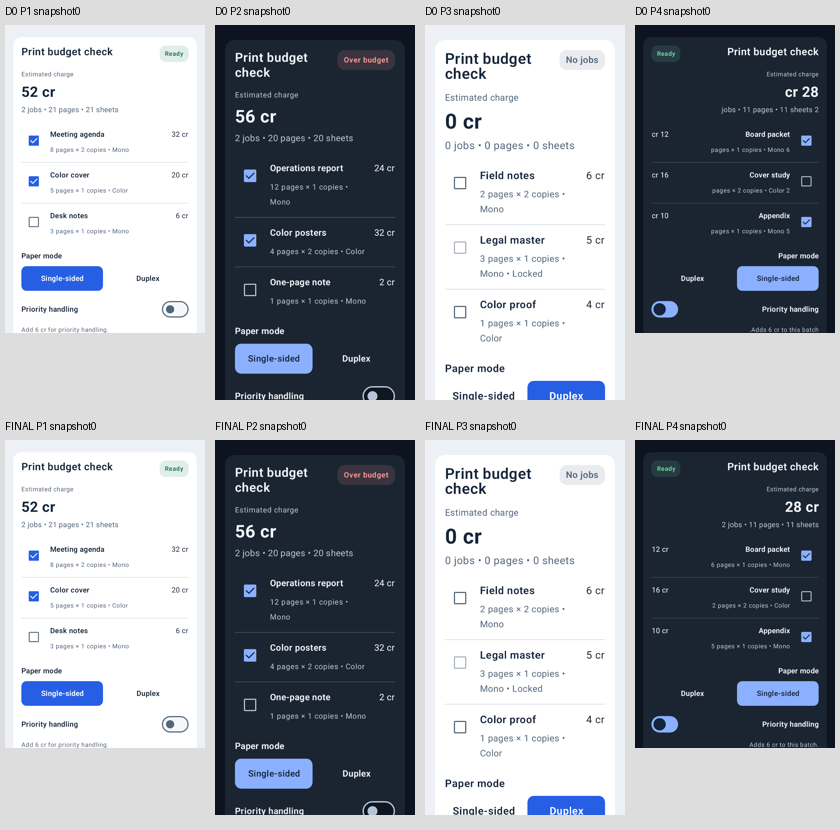
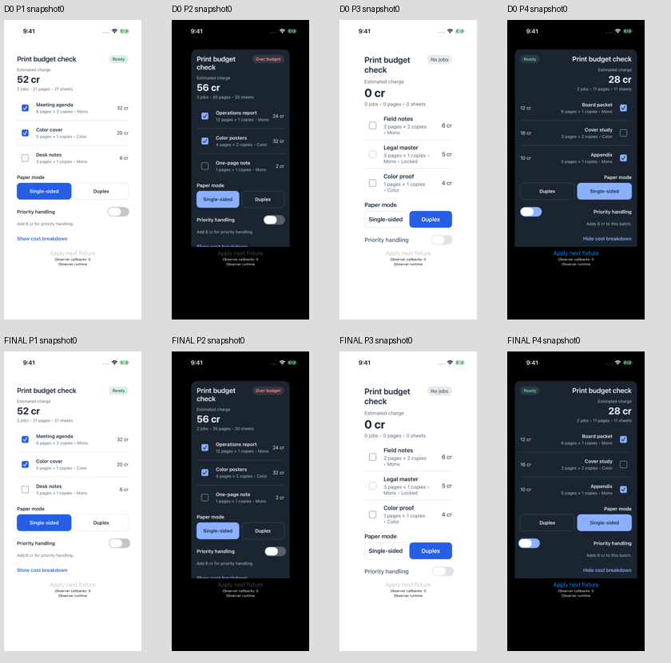
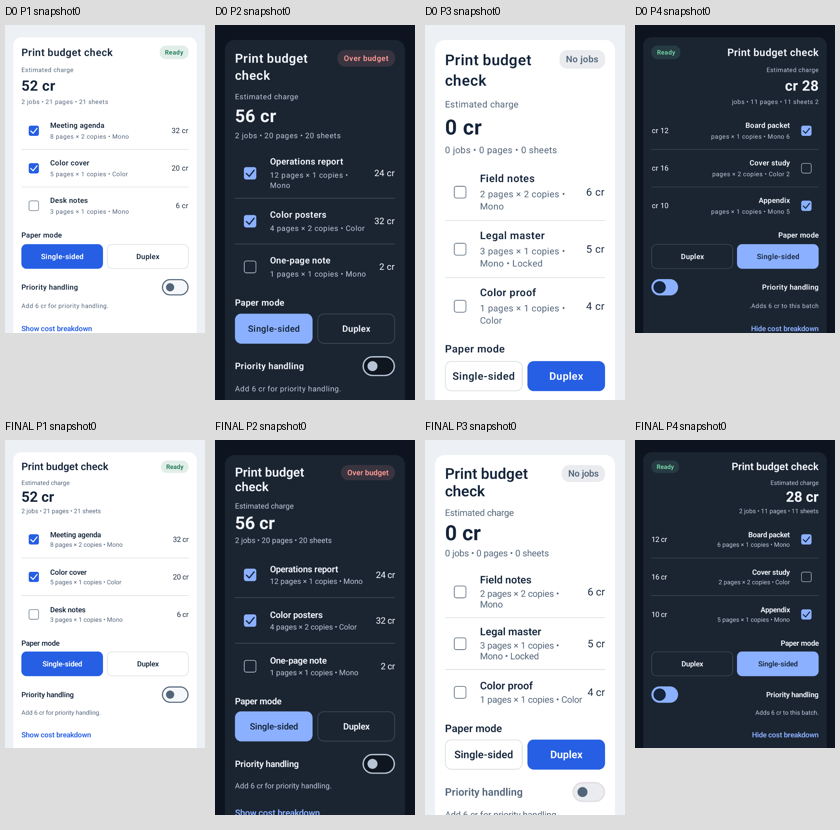

# 原图、参考和修正

设计在实现前固定，完整 SVG 和原生截图承担不同职责：SVG 规定层级、颜色、尺寸和语义，不是逐像素 golden。

下面按同一规则展示全部四个公共场景的初始视口：上排 D0，下排 FINAL。每格都是该次原生采集的 snapshot0，未按得分挑选。它们只能展示初始视口，不能证明完整滚动内容、后续状态、数值样式或物理点击区域。

单元 `unit-93485d` 的 iOS：

同单元 Android：

单元 `unit-fb632e` 的 iOS：

同单元 Android：

[画廊来源与图片哈希](gallery/provenance.json)记录全部32帧。完整原生证据在 `own-corpora/`、`common-corpora/`、`paired-corpora/`；匿名评估各阶段另有所有原图的审图清单、逐状态范围、缩略图索引和原尺寸放大记录。原始语料包括失败采集及后续状态，不用这些缩略图替代完整验收。

初版 `reference/reference.png` 是 QuickLook 截断的方形预览，保留作基础设施失败记录；两组实现前收到的是经检查的完整 `reference-full.png`。SVG 仍是权威设计来源。
