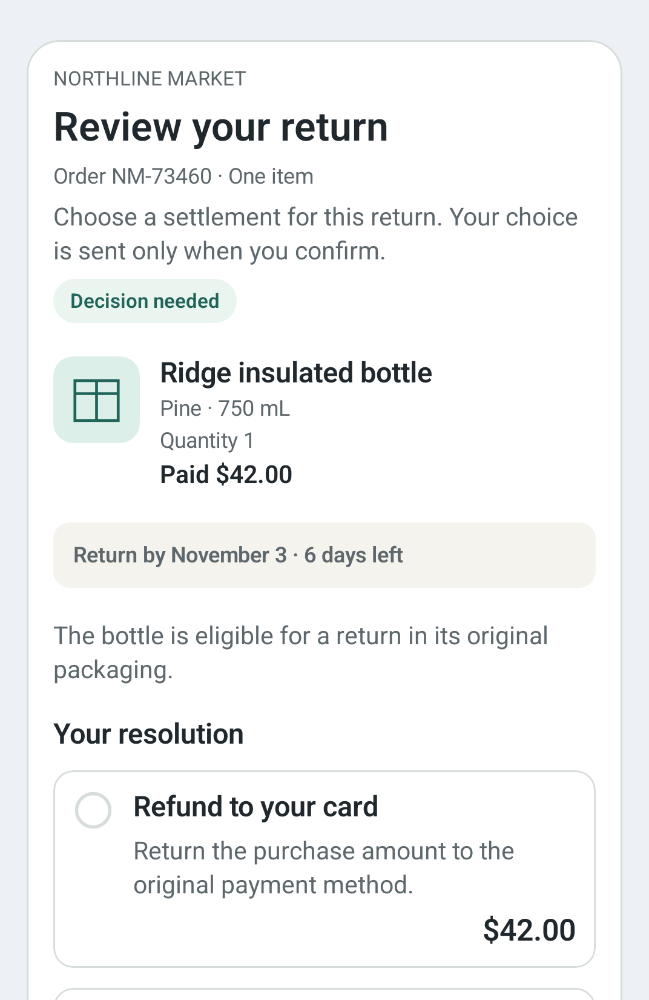
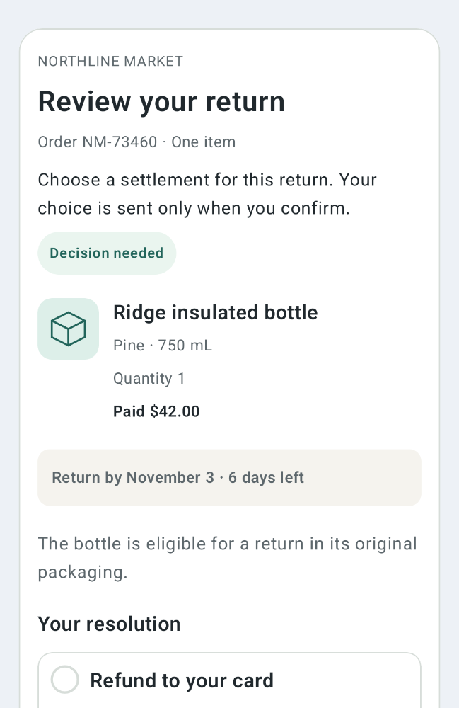
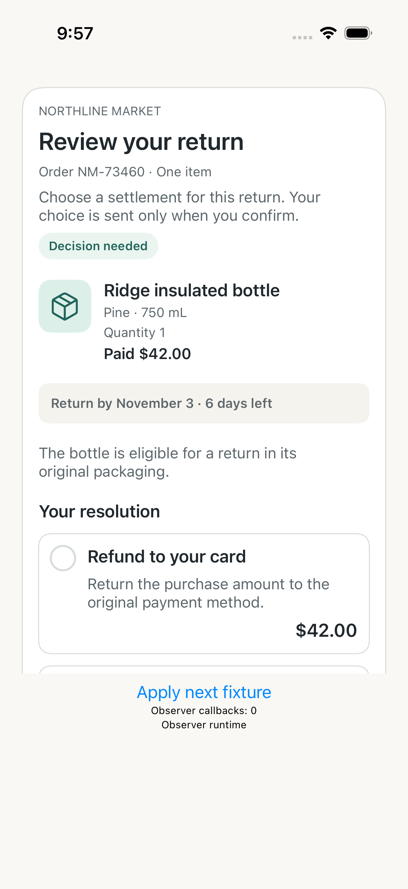
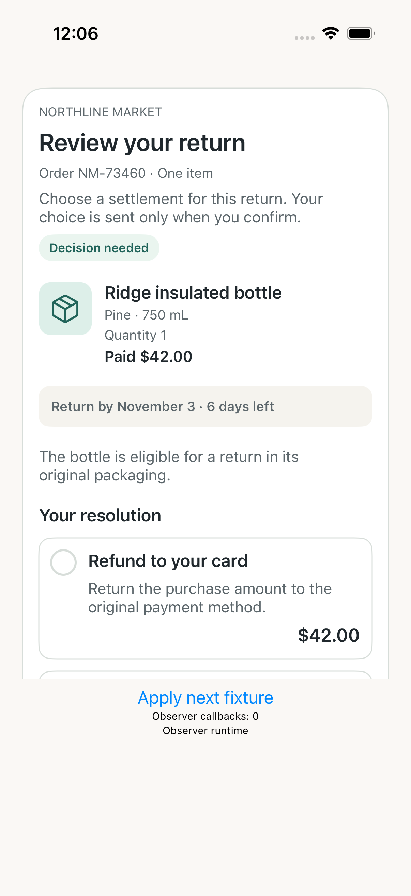
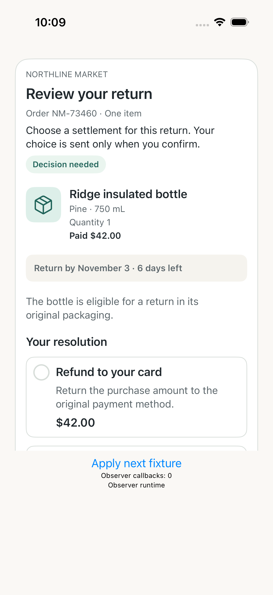

# 固定场景图片对照

选择规则在最终源码/保留场景披露前固定：C01 的第一个原生快照，两个平台、两组、前后阶段全部展示。图片保持原始文件；它们不是整体验收通过证明。缺图时保留失败日志链接，不以旧图补位。

| 平台 / 组 | 首版 | 修复后 |
| --- | --- | --- |
| android / baseline_v2 |  |  |
| android / candidate_v3 |  |  |
| ios / baseline_v2 |  |  |
| ios / candidate_v3 |  |  |

完整场景/状态/方面结果见 [原子账本](assessment-ledger.csv)；采集失败、覆盖缺口、无法评估的方法保留在原始证据及独立评分中。
